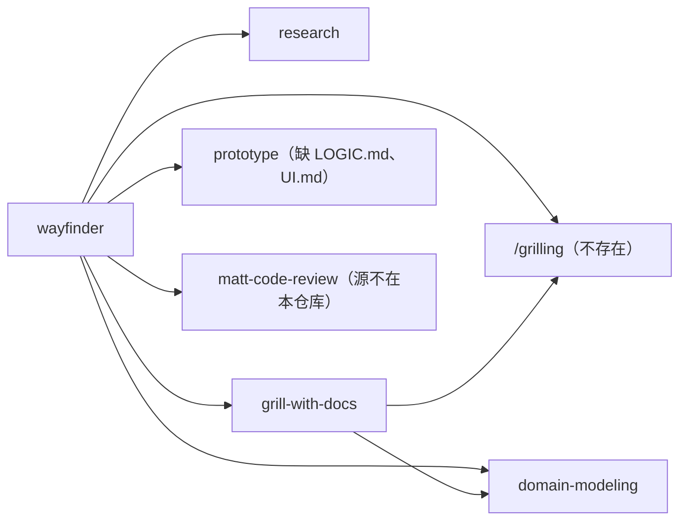
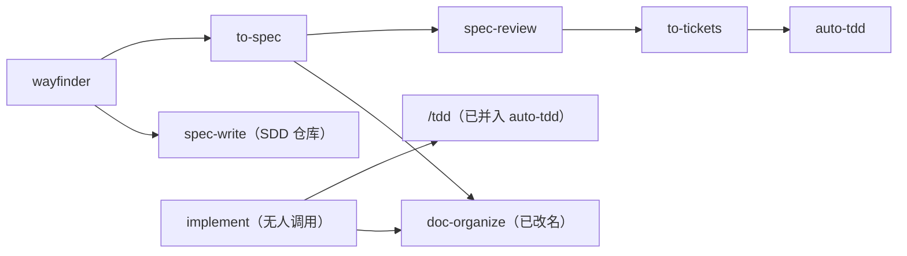
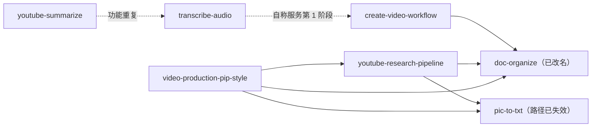

# skill-factory — skill 目录、调用关系与共性问题

本篇是 [skill-factory 设计](skill-factory-design.md) 的一个分篇（part）。
13 个必备章节只在入口文件里，本篇只回答三个问题。
第一，工厂里一共有哪些 skill，各自从哪里来。
第二，这些 skill 之间谁调用谁，连成了哪几条流水线，哪些调用已经断了。
第三，给每个 skill 反推规格（reverse-spec，即从现有代码和聊天记录倒推出需求和设计）时，反复出现了哪些共性问题。
本篇是汇总，细节都在各 skill 自己的规格里，这里只链接，不重复。
skill 的组成见 [为什么要做，一个 skill 怎么搭](skill-factory-design-why-and-anatomy.md)，验证和安装见 [怎么验证 skill，怎么安装和升级](skill-factory-design-verify-upgrade.md)。

## 证据从哪里来

仓库事实以 HEAD `ca8efab`（2026-11-24）为准，引用 commit 短哈希。
`SKILL.md:行号` 形式的引用都指 HEAD `ca8efab` 的文件。
各 skill 的问题引用它自己 design 里 Open Questions 表的编号，例如"auto-tdd 的 QUES-A"。
QUES 是 open question（未决问题）的编号前缀。
`research` 的规格放在子 feature `find-unknowns` 下（find-unknowns 的 ARD-L）。
`raw/` 路径是有效证据，即使别人打不开（SPEC-STANDARD 的 ARD-BW）。
用户原话引用会话 id 前 8 位加日期，多数转引自各 skill 的 PRD。
找不到证据的地方写 UNKNOWN，不猜。
下文的"建议"都等用户决定，不是决策。

## skill 目录

**DSGN-AF 目录。**
HEAD 一共有 26 份 SKILL.md：`skills/` 下 17 份，`personal-skills/` 下 9 份。
`skills/spec-html-standard/` 只放三份标准文件，没有 SKILL.md，所以不算一个 skill。
"来源"一列里，"自写"指需求出自用户自己的会话；"导入"指从别人的仓库拿来。
导入的 7 个都来自 Matt Pocock 的 mattpocock/skills，frontmatter 里都写了 `source_author: mattpocock` 和 `source_url`。
SDD 指 spec-driven-development（从规格驱动开发）这个 feature。
5 个 SDD skill 归那个 feature 管，本篇只列出，不分析，见 [spec-driven-development 设计](../../spec-driven-development/design/spec-driven-development-design.md)。

| skill | 目录 | 来源 | 一句话用途 | 规格 |
|---|---|---|---|---|
| auto-tdd | skills/ | 自写（ses_122b36d0，2026-06-19）；基本模式源自 mattpocock 的 tdd | 让 agent 按测试驱动开发写功能、修 bug | [design](../features/auto-tdd/design/auto-tdd-design.md) |
| bug | skills/ | 自写；由四个旧 skill 合成（commit `6086424`） | 找 bug 根因、报 issue、记录纠正并生成预防规则 | [design](../features/bug/design/bug-design.md) |
| domain-modeling | skills/ | 导入（commit `f6255af`） | 收紧术语，写术语表 CONTEXT.md 和 ADR | [design](../features/domain-modeling/design/domain-modeling-design.md) |
| english-grammar-fix | skills/ | 自写；前身是 ai-coworker 的 auto-patches | 修正 AI 写的英文里的小语法错误 | [design](../features/english-grammar-fix/design/english-grammar-fix-design.md) |
| grill-with-docs | skills/ | 导入（commit `6835420`） | 一问一答的拷问式访谈，同时写文档 | [design](../features/grill-with-docs/design/grill-with-docs-design.md) |
| implement | skills/ | 导入（commit `12c7dce`） | 按 spec 或 ticket 写代码，测试先行 | [design](../features/implement/design/implement-design.md) |
| multi-model-team | skills/ | 自写（ses_0a0d1e98，2026-07-13） | 架构师模型拆任务，工人模型实现 | [design](../features/multi-model-team/design/multi-model-team-design.md) |
| prototype | skills/ | 导入（commit `78242fa`） | 做一个用完就扔的原型来回答设计问题 | [design](../features/prototype/design/prototype-design.md) |
| research | skills/ | 自写；由 find-my-unknown 和 brainstorming 合成（commit `6086424`） | 动手前找出没想清楚的地方，或把想法写成设计 | [design](../features/find-unknowns/design/find-unknowns-design.md) |
| skill | skills/ | 自写（ses_14b5b4b7，2026-06-10）；由四个旧 skill 合成（commit `6086424`） | 在本仓库创建、修改、导入、列出 skill | [design](../features/skill/design/skill-design.md) |
| to-spec | skills/ | 导入（commit `212aab5`） | 把对话整理成一份 spec 发到 issue tracker | [design](../features/to-spec/design/to-spec-design.md) |
| to-tickets | skills/ | 导入（commit `8730941`） | 把计划拆成带阻塞关系的执行工单 | [design](../features/to-tickets/design/to-tickets-design.md) |
| wayfinder | skills/ | 导入并改造（commit `7c11a7b`） | 规划一个会话装不下的大任务，逐个定下决策 | [design](../features/wayfinder/design/wayfinder-design.md) |
| spec-write | skills/ | 自写 | 写 spec | SDD-owned |
| spec-review | skills/ | 自写 | 审 spec 或验收 | SDD-owned |
| spec-organize | skills/ | 自写 | 规格标准的参考文件，不是入口 | SDD-owned |
| spec-pipeline | skills/ | 自写 | 流水线阶段说明的参考文件，不是入口 | SDD-owned |
| create-video-workflow | personal-skills/ | 自写；最早来自 hackathon-video-gen 项目 | 把研究文档变成面向某类听众的演示或视频 | [design](../features/create-video-workflow/design/create-video-workflow-design.md) |
| doc-protect | personal-skills/ | 自写；最早是 walter-worker 的 doc-protection | 给文档段落加上或去掉"AI 不得改动"的标记 | [design](../features/doc-protect/design/doc-protect-design.md) |
| luma-event-scout | personal-skills/ | 自写（ses_0b3308c4，2026-07-10） | 在 Luma 上按用户标准找湾区 AI 活动 | [design](../features/luma-event-scout/design/luma-event-scout-design.md) |
| pic-to-txt | personal-skills/ | 自写（b1cdd2d6，2026-07-18） | 对一个文件夹的截图做文字识别，再用 LLM 修正 | [design](../features/pic-to-txt/design/pic-to-txt-design.md) |
| tmux-status-bar | personal-skills/ | 自写（commit `5cc3d4b`） | 改 tmux 底部状态栏显示的内容 | [design](../features/tmux-status-bar/design/tmux-status-bar-design.md) |
| transcribe-audio | personal-skills/ | 自写；借鉴本机 openclaw 项目的 openai-whisper skill | 用本机显卡上的 Whisper 把音频转成文字稿 | [design](../features/transcribe-audio/design/transcribe-audio-design.md) |
| video-production-pip-style | personal-skills/ | 自写，由 agent 一次写成（commit `9e4fb21`） | 一份画中画风格视频的手工制作指南 | [design](../features/video-production-pip-style/design/video-production-pip-style-design.md) |
| youtube-research-pipeline | personal-skills/ | 自写（commit `d7723a2`，2026-07-18） | 把一个话题做成带图表和文字稿的视频 HTML 页 | [design](../features/youtube-research/design/youtube-research-design.md) |
| youtube-summarize | personal-skills/ | 自写（commit `db0261d`） | 下载 YouTube 视频的文字稿并写总结 | [design](../features/youtube-summarize/design/youtube-summarize-design.md) |

2026-11-24 注：to-spec、to-tickets 已移除（`5370f61`），由 [spec-ingest](../features/spec-ingest/design/spec-ingest-design.md)、[spec-ticket](../features/spec-ticket/design/spec-ticket-design.md) 取代。

2026-11-24 注：两份规格已提交，子 feature 名为 `find-unknowns` 和 `youtube-research`。
初稿时它们标为 parked，原因是名字和已有 feature 重名：`research` 撞 `docs/features/discovery-research`，`youtube-research-pipeline` 撞 SDD 的 `pipeline` 子 feature（`raw/state/state-loop.md`）。
用户已定名，见上一句的注。

## 调用关系

**DSGN-AG 怎么数一条调用。**
本篇把"一个 SKILL.md 让 agent 去用另一个 skill"记作一条调用边。
写法有三种：`/名字` 这样的斜杠命令，正文里点名"调用某 skill"，以及"配套 skill"这类列表。
只在 When NOT to Use 里说"改用某 skill"的，算作转介，不算调用。
被调用的 skill 在本仓库和 `~/.claude/skills/` 下都找不到，就记为断边。
被调用的名字后来改了，SKILL.md 没跟着改，也记为断边。
以上边是逐个 grep 26 份 SKILL.md 得到的（HEAD `ca8efab`）。

**DSGN-AH 规划侧的调用。**
wayfinder 是调用最多的 skill。
它把待定的问题写成一张张 brief（问题卡片），按类型分给别的 skill 解决（`skills/wayfinder/SKILL.md:123-126`）。
research 类 brief 交给 `/research` 子 agent 无人值守地解决。
grilling 类 brief 交给 `/grilling` 和 `/domain-modeling` 一起和用户对话。
prototype 类 brief 交给 prototype。
接口表里，访谈一栏的默认实现是 grill-with-docs 加 domain-modeling（`SKILL.md:135`）。
交付前审查时，代码文件交给 matt-code-review（`SKILL.md:308`）。
grill-with-docs 的正文只有一句：用 domain-modeling 跑一次 `/grilling`（`skills/grill-with-docs/SKILL.md:31`）。
这里有两条断边。
第一，`/grilling` 在本仓库和 `~/.claude/skills/` 下都不存在，wayfinder 和 grill-with-docs 都调用它（grill-with-docs 的 QUES-A，domain-modeling 的 QUES-C）。
第二，prototype 链接的 `LOGIC.md` 和 `UI.md` 从没导入（`skills/prototype/SKILL.md:39-40`，prototype 的 QUES-A）。
matt-code-review 只在 `~/.claude/skills/` 下有一份部署副本，本仓库和 walter-worker 的 `skills/` 下都没有它的源，出处是 UNKNOWN。

**DSGN-AI 交付侧的调用。**
wayfinder 写明的交付顺序是 to-spec、spec-review、to-tickets、auto-tdd 四步（`skills/wayfinder/SKILL.md:276`）。
spec-review 是一道关口，通过了 to-tickets 才能跑（`SKILL.md:254`）。
在 SDD 仓库里，spec 不发成 issue，而是由 spec-write 写进 `docs/features/`（`SKILL.md:270`）。
implement 不在这条链上，没有任何 skill 调用它。
用户在导入 implement 一分钟后说"implement 我的替代是auto-tdd"（d8d2da7f，2026-08-02，见 [implement 的 PRD](../features/implement/prd/implement-prd.md)）。
implement 自己调用 `/tdd` 和 `/code-review`（`skills/implement/SKILL.md:30-34`）。
`/tdd` 已在 commit `6086424` 并入 auto-tdd，所以是断边（implement 的 QUES-B）。
`/code-review` 没说是哪一个（implement 的 QUES-C）。
implement 和 to-spec 都引用 `doc-organize/` 下的文件（`skills/implement/SKILL.md:40-41`，`skills/to-spec/SKILL.md:40-42`）。
doc-organize 在 commit `c44e983` 改名为 spec-organize，这些引用就断了（implement 的 QUES-A，to-spec 的 QUES-A）。

**DSGN-AJ 断边汇总。**
下表列出 HEAD `ca8efab` 上所有找到的断边。
"已有 QUES"一列为空的，是本篇新发现、各 skill 规格里还没记的。

| 调用方 | 断掉的引用 | 原因 | 已有 QUES |
|---|---|---|---|
| wayfinder、grill-with-docs | `/grilling` | 上游另一个 skill，导入时没拿 | grill-with-docs 的 QUES-A；domain-modeling 的 QUES-C |
| prototype | `LOGIC.md`、`UI.md` | 导入时只拿了 SKILL.md | prototype 的 QUES-A |
| implement | `/tdd` | 并入 auto-tdd（`6086424`） | implement 的 QUES-B |
| implement、to-spec | `doc-organize/` 下的文件 | 改名为 spec-organize（`c44e983`） | implement 的 QUES-A；to-spec 的 QUES-A |
| bug | `/doc-review design`（`skills/bug/SKILL.md:41`） | doc-review 改名为 spec-review（`c44e983`） | 无，[bug 的 design](../features/bug/design/bug-design.md) 原样转述了它 |
| bug | "run self-analyze"（`skills/bug/SKILL.md:128`） | self-analyze 已并入 bug 自己（`6086424`） | 无 |
| auto-tdd | contrarian review | 先并入 doc-review（`6086424`），doc-review 又改名（`c44e983`） | auto-tdd 的 QUES-G |
| create-video-workflow、youtube-research-pipeline、video-production-pip-style | `doc-organize` | 改名为 spec-organize（`c44e983`） | 无 |
| youtube-research-pipeline | `contrarian-review`（`SKILL.md:347`） | 并入 doc-review（`6086424`） | 无 |
| youtube-research-pipeline | `~/project/skill-factory/personal-skills/pic-to-txt/ocr.py`（`SKILL.md:107`） | 该目录已不存在 | pic-to-txt 的 QUES-F |
| tmux-status-bar | tmux-setup | 这个 skill 已不存在 | tmux-status-bar 的 QUES-E |

wayfinder 里原来也有 5 处 doc-review，commit `688cace`（2026-11-24 09:29）已改成 spec-review。
to-spec、to-tickets、wayfinder 三份规格写在这次修改之前，所以它们说"wayfinder 仍写 doc-review"已经过时，见 DSGN-AW。

## 流水线

**DSGN-AK wayfinder 交付流水线。**
这是本仓库最完整的一条流水线，从模糊的想法一直走到代码。
第一段是规划：wayfinder 建地图，把 brief 分给 research、grilling、prototype 去解决（DSGN-AH）。
第二段是写规格：普通仓库用 to-spec 发一个 issue，SDD 仓库用 spec-write 写进 `docs/features/`。
第三段是关口：spec-review 审过，才能拆工单。
第四段是交付：to-tickets 拆工单，auto-tdd 按工单写代码（DSGN-AI）。
2026-11-24 注：to-spec、to-tickets 已移除，流水线现为 wayfinder、spec-ingest、spec-write、spec-review、spec-ticket、auto-tdd。
spec-ticket 为每个 feature 开一张母工单，再为每条 IMPL-* 开一张工单（[spec-ticket](../features/spec-ticket/design/spec-ticket-design.md)）。
这条链现在有三处走不通。
grilling 类 brief 是默认类型（`skills/wayfinder/SKILL.md:125`），但它要的 `/grilling` 不存在。
research 类 brief 期待一个无人值守、产出带出处 markdown 的子 agent，但 research 的两条分支都先问用户问题（research 草稿的 QUES-A）。
prototype 类 brief 走 UI 或逻辑分支时，要读的两份说明文件不存在。
另外，用户要求所有代码都要审查，但 wayfinder 让 prototype brief 跳过审查关口（prototype 的 QUES-B）。

**DSGN-AL 视频流水线。**
视频相关的 6 个 skill 都在 `personal-skills/`，它们没有一个总入口来串联。
create-video-workflow 把研究文档变成演示、视频或网站，分 7 个阶段。
transcribe-audio 说自己服务于 create-video-workflow 的第 1 阶段（`personal-skills/transcribe-audio/SKILL.md:7`）。
但 create-video-workflow 并不调用它，而是把纯音频素材记为缺口（`personal-skills/create-video-workflow/SKILL.md:85`，create-video-workflow 的 QUES-D）。
hvg 仓库里的那份 create-video-workflow 加过这一步路由，本仓库的副本没有跟上（transcribe-audio 的 QUES-C）。
youtube-summarize 自带一套 Whisper 转写和 easyocr 截图识别（`personal-skills/youtube-summarize/SKILL.md:64-65`）。
这和 transcribe-audio、pic-to-txt 的功能重复，但它不调用这两个 skill（transcribe-audio 的 QUES-B，youtube-summarize 的 QUES-D）。
youtube-research-pipeline 的第 0 步调用 pic-to-txt 的 `ocr.py`，但路径指向已不存在的目录（DSGN-AJ）。
它的第 1 步派 3 个并行子 agent 查资料，这些是它自己的子 agent，不是 research skill。
video-production-pip-style 是一份手工指南，在"配套资源"一节列了 youtube-research-pipeline、pic-to-txt 和 doc-organize（`personal-skills/video-production-pip-style/SKILL.md:364-366`）。
把 youtube-summarize 和 youtube-research-pipeline 合成一个 `/youtube` 的提议，2026-08-02 被推迟（youtube-summarize 的 QUES-B）。

图中虚线不是调用：第一条是 transcribe-audio 单方面声称，第二条是功能重复。

**DSGN-AM 自愈和 bug 循环。**
自愈（self-heal）指 AI 记下用户对它的纠正，同类纠正重复出现后，自动写成预防规则。
这件事集中在 bug skill 的三条分支里（`skills/bug/SKILL.md`）。
Hunt 分支找根因并修好，第 5 阶段问用户要不要跑 Heal 分支（`SKILL.md:94`）。
Report 分支把 walter-worker 自身的问题写成 GitHub issue，然后也接 Heal 分支（`SKILL.md:108`）。
Heal 分支把纠正写进 `.self-healing/traces/`，同类纠正出现 2 次以上，就把规则注入项目 CLAUDE.md 的 SELF-ANALYZE 块（`SKILL.md:116-139`）。
research 在 When NOT to Use 里说，已经在实现阶段就改用 `/bug hunt`（`skills/research/SKILL.md:43`）。
auto-tdd 的完成标准要求修代码时，连同放过这个 bug 的 spec 和 skill 一起修（`skills/auto-tdd/SKILL.md:123`）。
这个循环现在不会自己转起来。
`~/.claude/hooks/on-self-heal.sh` 文件存在，但没有在 `~/.claude/settings.json` 里注册（本篇 2026-11-24 核对，bug 的 QUES-D）。
Report 分支写死了目标仓库 `cicidi/walter-worker`（`SKILL.md:107`，bug 的 QUES-C）。
全局 CLAUDE.md 里还有一个 walter-worker-fix skill 处理同一类问题，两者没有分工（bug 的 QUES-F）。

## 共性问题

下面每一条问题都在至少两个 skill 里出现过，并附上 commit 证据和受影响的 QUES。

**DSGN-AN 2026-08-02 的合并删掉了用户要过的功能。**
commit `6086424` 把 38 个 ai-coworker skill 合成 11 个。
bug 的合并输入是本仓库的旧副本，不是 walter-worker 里的新版（bug 的 decision-history）。
结果是用户要过的改动和测试场景被删了。
auto-tdd：每做一点就提交、每 30 分钟自查一次都被删（auto-tdd 的 QUES-A、QUES-B），7bfe010 版的 5 个测试场景也删了。
bug：先收集证据再推理、深挖模式、先选仓库、先检查 hook 都被删（bug 的 QUES-A 到 QUES-D）。用户 06-23 要的新版只在 walter-worker 历史里（f8b7ffb、6511f37、5138ea3）。
skill：合并前 skill-import 的描述写着"preserving original authorship"（`git show 6086424^:ai-coworker-skills/skill-import/SKILL.md` 第 7 行），合并后没有了（skill 的 QUES-C）。
research：实现后的小测验和实现中的再访谈被删（research 草稿的 QUES-B、QUES-C），用户后来用过"/research 你来考考我"（d8d2da7f）。
是有意删减还是合并时漏掉，各 skill 的 decision-history 都写 UNKNOWN。

**DSGN-AO 从 mattpocock/skills 导入时只拿了 SKILL.md。**
2026-08-02 一天导入了 7 个 skill，多数 commit 只加了一个 SKILL.md。
grill-with-docs（`6835420`）只有 31 行，它要调用的 `/grilling` 是上游另一个 skill，没有一起导入（grill-with-docs 的 QUES-A）。
prototype（`78242fa`）只加了 SKILL.md，上游的 `LOGIC.md`、`UI.md` 和 `agents/` 都没拿（prototype 的 QUES-A）。2026-11-05 用户实际使用时碰到了这个问题（会话 1afe4b90，见 prototype 的 design）。
domain-modeling（`f6255af`）是反例，它一起导入了 `ADR-FORMAT.md` 和 `CONTEXT-FORMAT.md`。
导入后也没跟进上游更新：grill-with-docs 缺上游后来加的 `disable-model-invocation: true`（grill-with-docs 的 QUES-B），domain-modeling 缺 META.yaml（domain-modeling 的 QUES-D）。
`/skill import` 的步骤里没有"检查依赖的文件和 skill 是否一并导入"这一步（`skills/skill/SKILL.md`，skill 的 QUES-B）。

**DSGN-AP commit `c44e983` 改名后留下死引用。**
`c44e983`（2026-11-04）把 doc-organize 改名为 spec-organize，把 doc-review 改名为 spec-review。
这次 commit 没有改任何非 SDD 的 skill。
改名前，有 7 个非 SDD 的 SKILL.md 引用旧名字（`git grep` 于 `c44e983^`）：bug、implement、to-spec、wayfinder、create-video-workflow、youtube-research-pipeline、video-production-pip-style。
只有 wayfinder 在 `688cace` 修好了，其余 6 个至今仍是断边（DSGN-AJ）。
受影响的 QUES：implement 的 QUES-A，to-spec 的 QUES-A。另外 4 个 skill 的规格还没记这件事。
`/skill` 和 walter-worker 的 `install.sh` 都不检查断掉的 skill 引用（skill 的 QUES-A；verify-upgrade 篇的 DSGN-W）。

**DSGN-AQ 外部环境搬家后，路径失效。**
skill 写死了别的仓库或旧目录里的路径，那边一搬家，skill 就跑不起来。
create-video-workflow 调用 `tools/` 下的脚本，但 hvg 仓库在 v3 之前已改名为 `scripts/`（hvg commit b805482）；项目目录也已搬到 video-gen-initiative 仓库（create-video-workflow 的 QUES-A、QUES-B）。
youtube-research-pipeline 调用 `~/project/skill-factory/` 下的 `ocr.py`，这个目录已不存在（pic-to-txt 的 QUES-F）。
multi-model-team 要求 opencode 里配好 architect 和 worker 两个 agent，本机 `~/.config/opencode/opencode.json` 没有（multi-model-team 的 design，Risks 表）；配置示例的模型名也和用户实际用的不同（multi-model-team 的 QUES-C）。
其中 create-video-workflow 和 multi-model-team 找不到成功运行的记录（create-video-workflow 的 design；multi-model-team 的 QUES-G）。

**DSGN-AR 用户改了要求，SKILL.md 没跟上。**
tmux-status-bar：用户 07-13 要求 feature 从 CLAUDE.local.md 读，08-01 要求只显示文件夹路径，SKILL.md 仍是 07-01 的五字段版（tmux-status-bar 的 QUES-B、QUES-C）。
wayfinder：用户说"3 yes"，同意把定终点做成第一张 brief，SKILL.md 仍把它写成一个步骤（wayfinder 的 QUES-A）。
implement：用户说用 auto-tdd 替代它，它仍原样留在 `skills/`（implement 的 QUES-D，to-tickets 的 QUES-C）。
to-tickets：用户要 to-tickets 建 spec 的 ticket，wayfinder 却交给 to-spec（to-tickets 的 QUES-A，wayfinder 的 QUES-E）。
luma-event-scout：偏好一节写搜一个月，过滤代码写 10 天（luma-event-scout 的 QUES-A）。

**DSGN-AS 功能重叠，没有分工。**
几对 skill 做同一件事，但谁负责什么没写清楚。
transcribe-audio 和 youtube-summarize 各有一套 Whisper 转写（transcribe-audio 的 QUES-B，youtube-summarize 的 QUES-D）。
to-spec 和 spec-write 都写 spec，SDD 只承认 spec-write 是入口（to-spec 的 QUES-C）。
implement 和 auto-tdd 都按工单写代码（implement 的 QUES-D）。
english-grammar-fix 和 commit 都规定 commit message 的格式（english-grammar-fix 的 QUES-C）。
bug 的 Report 分支和 walter-worker-fix 都处理 walter-worker 自身的问题（bug 的 QUES-F）。
research 的触发词 prototype 和 prototype skill 重名（research 草稿的 QUES-H）。

**DSGN-AT agent 写得比用户要的多，或者改文件前不问。**
有些内容是 agent 自行加的，用户没有逐条确认。
multi-model-team 的触发语和多级失败处理都比用户在访谈里选的宽（multi-model-team 的 QUES-A、QUES-B、QUES-F）。
video-production-pip-style 由 agent 一次写成，会话里没有后续确认（[它的 PRD](../features/video-production-pip-style/prd/video-production-pip-style-prd.md)）。
research 的停止条件"连续两次你看着办"是 agent 写的（research 草稿的 QUES-E）。
有两个 skill 直接改用户的文件，事先不问。
tmux-status-bar 直接替换 `~/.tmux.conf`，不备份也不确认（tmux-status-bar 的 QUES-D）。
doc-protect 每次加、减保护后都自动提交（doc-protect 的 QUES-A）。

**DSGN-AU 原作者出处丢了。**
用户最初要求导入的 skill "复合版权，著名出处"（ses_14b5b4b7，2026-06-10，见 why-and-anatomy 篇的 DSGN-A）。
auto-tdd 的基本模式来自 mattpocock/skills，commit d98ed8d（2026-06-11）删掉了 `source` 字段（auto-tdd 的 QUES-F）。
research 只在正文提到原文作者，`source` 和 `source_url` 字段没有了（research 草稿的 QUES-D）。
`/skill import` 的步骤里不记录原作者（skill 的 QUES-C，见 DSGN-AN）。
2026-08-02 导入的 7 个 skill 倒是都带了 `source_author` 和 `source_url`。

**DSGN-AV 仓库里的说明和实际不一致。**
`.scratch/` 没有被 gitignore，但 commit `e1465f1` 说它被忽略了（`git check-ignore` 于 2026-11-24 核对，to-tickets 的 QUES-D）。
本地工单因此可能被误提交。
grill-with-docs 和 domain-modeling 的导入日期，`docs/book/imported-skills.md` 写 2026-07-25，git 是 2026-08-02（grill-with-docs 的 QUES-C）。
domain-modeling 把 ADR 写到 `docs/adr/`，本仓库的标准要求写进 decision-history（domain-modeling 的 QUES-A）。

**DSGN-AW 有三份规格写完当天就部分过时。**
to-spec（`1c6b5b3`，05:52）、to-tickets（`598e86a`，06:24）、wayfinder（`3ed20a5`，06:53）的规格写于 2026-11-24 上午。
同日 09:29 的 `688cace` 把 wayfinder 里的 doc-review 全部改成了 spec-review。
所以 to-spec 的 QUES-F、to-tickets 的 QUES-F、wayfinder 的 QUES-D 里"wayfinder 仍写 doc-review"这半句已不成立。
wayfinder 的 QUES-D 里关于 `/grilling` 的另半句仍成立。
这说明逐个反推规格时，被引用的 SKILL.md 可能在同一天又被改动。

## 建议的修复

下表是建议，等用户决定，不是决策。
"严重度"指不修会怎样：高是 skill 会损坏用户的东西或核心流水线走不通，中是某个 skill 跑不通，低是规格和现实不符但不影响运行。
"工作量"小指一处到几处文字改动，中指要补文件或改流程，大指要重新设计。
顺序一列只是位置，不是永久编号。

| 顺序 | 建议 | 严重度 | 工作量 | 涉及的 skill | 依据 |
|---|---|---|---|---|---|
| 1 | tmux-status-bar 的 QUES-C 定下来之前先别运行它；改的时候加上备份和确认 | 高 | 小 | tmux-status-bar | 它的 QUES-C（blocking）、QUES-D |
| 2 | 导入上游的 grilling skill，或者把 `/grilling` 改指 grill-with-docs | 高 | 小 | grill-with-docs、wayfinder、domain-modeling | grill-with-docs 的 QUES-A；DSGN-AK |
| 3 | 给 research 加一条无人值守、产出带出处 markdown 的分支，让 wayfinder 能用 | 高 | 中 | research、wayfinder | research 草稿的 QUES-A |
| 4 | 补导 prototype 的 `LOGIC.md`、`UI.md` 和 `agents/` | 中 | 小 | prototype | 它的 QUES-A |
| 5 | 把 7 个 skill 里的 doc-organize、doc-review、contrarian-review、self-analyze 改成现在的名字 | 中 | 小 | bug、implement、to-spec、auto-tdd、create-video-workflow、youtube-research-pipeline、video-production-pip-style | DSGN-AJ、DSGN-AP |
| 6 | 改 youtube-research-pipeline 里 `ocr.py` 的路径 | 中 | 小 | youtube-research-pipeline | pic-to-txt 的 QUES-F |
| 7 | 已完成（2026-11-24，`85604c5`）：在 `.gitignore` 加一行 `.scratch/` | 中 | 小 | to-tickets、wayfinder | to-tickets 的 QUES-D |
| 8 | 决定 implement 的去留：删除、转调 auto-tdd，或者改成可替换的接口 | 中 | 小 | implement、auto-tdd | implement 的 QUES-B、QUES-D |
| 9 | 改 create-video-workflow 的脚本路径和项目目录，并加上调用 transcribe-audio 的路由 | 中 | 中 | create-video-workflow、transcribe-audio | create-video-workflow 的 QUES-A、QUES-B、QUES-D |
| 10 | 注册 self-heal hook，并让 Report 分支先问目标仓库 | 中 | 中 | bug | bug 的 QUES-C、QUES-D |
| 11 | 已完成（2026-11-24）：定名 find-unknowns 和 youtube-research，规格已提交 | 中 | 小 | research、youtube-research-pipeline | `raw/state/state-loop.md` 的 Questions 一节 |
| 12 | 写一个检查脚本，找出 SKILL.md 里指向不存在的 skill 或文件的引用 | 中 | 中 | 全部 | skill 的 QUES-A；DSGN-AP |
| 13 | 逐条决定是否恢复 08-02 合并删掉的功能 | 低 | 大 | auto-tdd、bug、skill、research | DSGN-AN |
| 14 | 给功能重叠的几对 skill 写明分工，或合并 | 低 | 中 | 见 DSGN-AS | DSGN-AS |
| 15 | 恢复出处字段，并在 `/skill import` 里加上记录出处和检查依赖两步 | 低 | 小 | skill、auto-tdd、research | DSGN-AO、DSGN-AU |
| 16 | 已完成（2026-11-24）：更新 to-spec、to-tickets、wayfinder 三份规格里关于 doc-review 的过时说法 | 低 | 小 | to-spec、to-tickets、wayfinder | DSGN-AW |

## 未知项

- matt-code-review 和 commit 两个 skill 的源在哪个仓库：只在 `~/.claude/skills/` 下找到部署副本，UNKNOWN。
- 08-02 合并删掉那些功能是有意还是遗漏：各 skill 的 decision-history 都写 UNKNOWN。
- youtube-research-pipeline 是否被实际用过、效果如何：没有它的规格，本篇也没有查会话记录，UNKNOWN。
- create-video-workflow v3 是否完整跑通过：UNKNOWN（create-video-workflow 的 design）。
- hvg 仓库的 commit b805482 本篇没有在 hvg 仓库里重新核对，转引自 create-video-workflow 的 design。

## Change Log

| Date | Change |
|------|--------|
| 2026-11-24 | 初版：skill 目录、调用关系与断边、三条流水线、共性问题和建议修复 |
| 2026-11-24 | 目录表后和 DSGN-AK 加注：to-spec、to-tickets 已移除并被取代；建议表第 7、16 条标为已完成 |
| 2026-11-24 | research、youtube-research-pipeline 的规格已提交，去掉 parked；建议表第 11 条标为已完成 |
