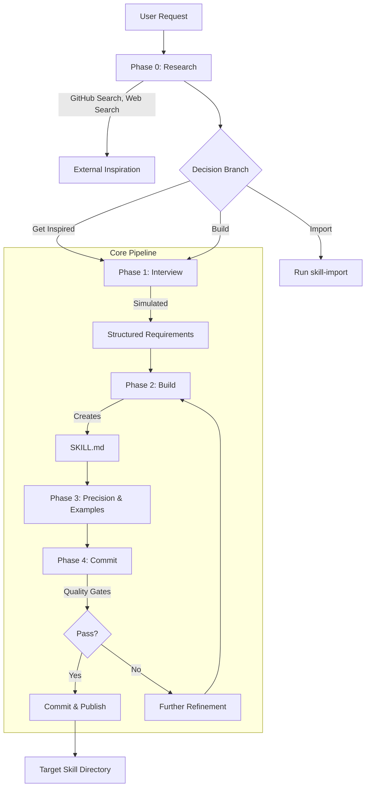

# skill-factory Specification

## Specification

# skill-factory Technical Specification

**Version:** 1.0  
**Status:** Implemented  
**Last Updated:** 2026-07-23

---

## System Architecture Overview

The **skill-factory** is a skill management and creation system for the OpenCode/Claude Code ecosystem. It organizes skills into three isolated directories, provides creation, editing, and import workflows, and enforces quality gates through a defined specification format.

### 1.1 High-Level Structure

```
<project-root>/
├── walter-worker-skills/          # Native (first-party) skills
├── import-skills/               # Imported third-party skills
├── personal-skills/             # Private user skills (gitignored)
├── docs/
│   ├── devil-advocate/          # Devil's advocate debate outputs
│   ├── work-review/             # Work review acceptance outputs
│   └── ...                      # Other doc types
├── CONVENTIONS.md               # Project conventions
├── CLAUDE.md                    # Agent behavior rules
└── .gitignore                   # Excludes personal-skills/
```

### 1.2 Skill Lifecycle

- **Create**: via `skill-create` (self-bootstrapping process: Phase 0→1→2→3→4)
- **Edit**: via `skill-edit` (Step 1→2→3→4→5→6→7)
- **Import**: via `skill-import` (fetch → convert → audit → register)
- **Publish**: via conventional commit + quality gate validation
- **Personal**: via symlink (gitignored, not in marketplace)

### 1.3 Runtime Environment

- Skills execute within **Claude Code** (CLI) and **OpenCode** (GUI) environments
- OpenCode installation: git plugin + project-level symlink
- Claude Code: local marketplace via `extraKnownMarketplaces`
- Skills can be triggered via trigger keywords defined in skill frontmatter

---

## Key Interfaces / APIs

### 2.1 SKILL.md Frontmatter Format (5-field)

All skills must have exactly these five frontmatter fields:

| Field | Description | Rules |
|-------|-------------|-------|
| `name` | Skill name | kebab-case; walter-worker- prefix for native/personal |
| `description` | One-line purpose | Must start with "Use when..." |
| `license` | License type | Default: MIT |
| `compatibility` | Compatible platforms | Default: "opencode, claude-code" |
| `trigger` | Activation keywords | Comma-separated; inferred from description+body |

**Example:**
```yaml
---
name: walter-worker-dev-advocate
description: Use when you need adversarial review of specs or design docs
license: MIT
compatibility: opencode, claude-code
trigger: review spec, 杠精, devil advocate, adversarial review
---
```

### 2.2 META.yaml Schema (Import Only)

Required for every imported skill in `import-skills/`:

```yaml
source: <URL or repo>                     # Required
upstream_commit: <commit hash>            # Required
license: <SPDX identifier>               # Required
imported_at: <ISO 8601 timestamp>         # Required
imported_by: <author/github handle>       # Required
note: <free text>                         # Optional
```

### 2.3 Skill Workflow Interfaces

#### 2.3.1 `skill-create` (Self-Bootstrapping Process)

**Entry**: No target exists  
**Phases**:
| Phase | Action | Output |
|-------|--------|--------|
| 0 | Multi-source search (GitHub ≥10 repo results, web search) | Decision: import / absorb inspiration / build from scratch |
| 1 | Interview (user role simulation) | Requirements |
| 2 | Build SKILL.md following 5-field frontmatter + CONVENTIONS.md body | Draft SKILL.md (≤150 lines) |
| 3 | Precision & Examples with legal-clause bounds + 2-3 example spectrum | Refined SKILL.md |
| 4 | Quality gates validation + commit + publish | Final SKILL.md |

**Quality Gates (MUST — block commit)**:
- `description ≤ 500 characters`
- `Body < 150 lines` (hardened from 500)
- `No deploy/ concept` (prevent invalid structures)
- `Quality Gates section present with MUST/NICE checkboxes`
- `Anti-Patterns section present`
- `Philosophy-driven overview`

**Quality Gates (NICE — warn only)**:
- `description ≤ 500 chars`
- `Anti-Patterns section present`
- `Quality Gates section present`
- `Philosophy-driven overview`
- `Body < 150 lines`

#### 2.3.2 `skill-edit` (Modification Workflow)

**Entry**: Target exists and change < 80% rewrite  
**Steps**:
1. **Check existence**: If not exists → redirect to `skill-create`
2. **Fetch source**: Use `webfetch` (preferred) or `curl`
3. **Assess scope**: If ≥80% rewrite → redirect to `skill-create`
4. **Present diff summary** → get user approval
5. **Make targeted edits** (Edit tool only, never Write entire file, never create new file)
6. **Run quality gates** (MUST gates block commit)
7. **Publish** with conventional commit message

#### 2.3.3 `skill-import` (Third-Party Conversion)

**Entry**: External source URL/repo  
**Steps**:
1. **Fetch source** SKILL.md using webfetch/curl
2. **Auto-convert frontmatter**:
   - `name` → kebab-case
   - `description` → begins with "Use when..."
   - `license` → MIT (default)
   - `compatibility` → "opencode, claude-code" (default)
   - `triggers` → inferred from description and body
3. **Auto-adapt body sections**:
   - Philosophy → overview
   - Anti-Pattern → Anti-Patterns
   - Workflow → Process
   - Checklist → Quality Gates
   - Remove: Changelog, Convention Notes
4. **Write META.yaml** with source, upstream_commit, license, imported_at, imported_by
5. **Place in** `import-skills/<name>/SKILL.md`
6. **Validate quality gates** → commit

**Ambiguity Triggers**: Ask user one question at a time only when:
- No license specified
- Triggers are unclear
- Unknown body section encountered

#### 2.3.4 `devil-advocate` (Adversarial Review)

**Architecture**: Main agent orchestration with 3 stateless subagents per round  
**Process**:
1. Con agent → presents arguments against
2. Pro agent → defends position
3. Judge agent → summarizes and identifies unresolved points
4. **Limit**: Max 5 rounds; unresolved points resolved by 3-agent majority vote

**Output**: `{project-path}/docs/devil-advocate/YYYY-MM-DD-<topic>/`
- `discussion.md` — full debate transcript
- `report.md` — human-readable summary

**Triggers**: `review spec`, `杠精`, `devil advocate`, `adversarial review`

#### 2.3.5 `work-review` (Acceptance Gatekeeper)

**Architecture**: Sequential 2-agent (Collector → Reviewer), no auto-retry  
**Agent 1 (Collector)**:
- Writes test plan (scenarios, types, steps)
- **Does NOT** write executable test code

**Agent 2 (Reviewer)**:
- Executes test plan
- Runs existing UT/FT
- Writes Playwright tests for E2E
- Uses curl/httpie for manual tests
- Validates each acceptance criterion

**Output**: `{project-path}/docs/work-review/YYYY-MM-DD-<topic>/`
- `acceptance.md` — test plan
- `report.md` — execution results

**Triggers**: `work review`, `acceptance`, `sign off`, `verify work`

---

## Data Models / Schemas

### 3.1 Skill Definition (SKILL.md)

**Structure**:
```yaml
---
name: <string>                        # 5-field frontmatter
description: <string>                 # Must start "Use when..."
license: <string>                     # Default: MIT
compatibility: <string>               # Default: "opencode, claude-code"
trigger: <string>                     # Comma-separated
---

# Overview
<philosophy-driven description>        # Mapped from Philosophy

## Process
<workflow description>                 # Mapped from Workflow

## Anti-Patterns
- <list of common mistakes>           # Required section

## Quality Gates
### MUST (block)
- [ ] <gate description>
### NICE (warn)
- [ ] <gate description>
```

**Constraints**:
- Body (excluding frontmatter): ≤150 lines (target; soft limit)
- File must end with newline

### 3.2 Import Metadata (META.yaml)

```yaml
source: <url>
upstream_commit: <

## Skill Consolidation (2026-08-02)

# Skill Consolidation Spec

> **Status:** design approved, pending implementation
> **Date:** 2026-08-02

## Goal

Reduce walter-worker-skills from 38 to 13 by merging skills that are near-duplicates,
complementary, or naturally grouped. Each merged skill uses conversation-driven
branching (Option A pattern): ask clarifying questions upfront, then route to the
right logic path.

## Principles

1. **Merge logic, don't just stack** — genuinely fuse the workflows; when they
   differ, branch on parameters/conditions.
2. **Ask first** — every merged skill starts by asking what the user wants,
   presents options, then branches.
3. **Severity gate for reviews** — `doc-review` uses a 5-point severity scale;
   only level 3+ issues are discussed. Level 1-2 issues are skipped to avoid
   bikeshedding and over-engineering.
4. **Simple subcommands for CRUD sets** — `/initiative`, `/project`, `/skill`,
   `/dashboard` accept subcommands directly (like git).

## Merge Map

### Category 3 — Natural CRUD Sets (subcommand-driven)

| # | Merged Name | Subcommands | Absorbed | Reduction |
|---|-------------|------------|----------|-----------|
| 1 | **`/initiative`** | `create`, `edit`, `activate`, `deactivate`, `list`, `show`, `delete` | initiative-create, initiative-edit, initiative-activate, initiative-deactivate, initiative-list, initiative-show, initiative-remove (7) | -6 |
| 2 | **`/dashboard`** | `start [--daemon]`, `import [--files]`, `stop` | analytics-create-db, analytics-daemon, analytics-dashboard, analytics-import, analytics-once (5) | -4 |
| 3 | **`/project`** | `add`, `edit`, `remove`, `list`, `show`, `sync` | project-add, project-edit, project-remove, project-list, project-show, project-sync (6) | -5 |
| 4 | **`/skill`** | `create`, `edit`, `import`, `list` | skill-create, skill-edit, skill-import, skill-list (4) | -3 |

### Category 1 — Near-Duplicates (conversation-branch)

| # | Merged Name | Branches | Absorbed | Reduction |
|---|-------------|----------|----------|-----------|
| 5 | **`/doc-review`** | `design review` (adversarial stress-test for specs/designs) / `work completion review` (acceptance check against PRD/design) | devil-advocate, contrarian-review, work-review (3) | -2 |
| 6 | **`/bug`** | `hunt` (scientific debug: hypothesis→test→fix) / `report` (file GitHub issue) / `heal` (record correction → analyze patterns → generate prevention rules) | bug-hunt, bug-report, self-analyze, self-heal (4) | -3 |

### Category 2 — Complementary (auto-detect + branch)

| # | Merged Name | Branches | Absorbed | Reduction |
|---|-------------|----------|----------|-----------|
| 7 | **`/doc-organize`** | `organize` (decide placement/naming/maintain INDEX.md) / `merge` (resolve upstream sync conflicts with protected blocks) | doc-merge, doc-organize (2) | -1 |
| 8 | **`/knowledge`** | `obsidian vault` (extract memory cards from sessions → Obsidian) / `sqlite analytics` (LLM analysis → session_summaries + knowledge cards → analytics.db) | session-memory, knowledge-skill (2) | -1 |
| 9 | **`/auto-tdd`** | `basic` (red-green-refactor from imported tdd) / `auto` (multi-agent continuous TDD loop with arbiter + quality judge) | auto-tdd, tdd (import) (2) | -1 |
| 10 | **`/research`** | `discover unknowns` (interview-style, surface blind spots before coding) / `design spec` (brainstorming → design → spec → transition to plan) | find-my-unknown, superpowers:brainstorming (2) | -1 |

### Independent — No Merge

| Skill | Reason |
|-------|--------|
| `english-grammar-fix` | Pure utility, no overlap with anything |
| `multi-model-team` | Unique multi-model architecture, distinct workflow |
| `status` | Simple CLI passthrough, just runs `coworker status` |

## Internal Structure (Option A Pattern)

Each merged SKILL.md follows this structure (illustrative — not the actual content):

```markdown
---
name: example-skill
description: Use when the user wants to ... (describe trigger, not workflow)
---
...

## Dashboard Merge Detail

5 → 1: `/dashboard [start|import|stop]`

| Subcommand | Behavior |
|------------|----------|
| `start` (default) | Launch web dashboard on localhost:8080. DB auto-created if missing. `--daemon` flag enables background auto-import |
| `import` | One-shot scan and import. `--files <paths>` for specific files |
| `stop` | Stop the daemon if running |

`analytics-create-db` is removed — DB creation happens automatically on first use.
`analytics-once` and `analytics-import` are merged — `import` without `--files` does a full scan.

## Files Changed

| File | Change |
|------|--------|
| `walter-worker-skills/initiative/SKILL.md` | New merged skill (replaces 7) |
| `walter-worker-skills/dashboard/SKILL.md` | New merged skill (replaces 5) |
| `walter-worker-skills/project/SKILL.md` | New merged skill (replaces 6) |
| `walter-worker-skills/skill/SKILL.md` | New merged skill (replaces 4) |
| `walter-worker-skills/doc-review/SKILL.md` | New merged skill (replaces 3) |
| `walter-worker-skills/doc-organize/SKILL.md` | Merged skill (replaces 2) |
| `walter-worker-skills/bug/SKILL.md` | New merged skill (replaces 4) |
| `walter-worker-skills/knowledge/SKILL.md` | Merged skill (replaces 2) |
| `walter-worker-skills/auto-tdd/SKILL.md` | Merged skill (replaces 2) |
| `walter-worker-skills/research/SKILL.md` | New merged skill (replaces 2) |

Old skill directories to delete: 35 total (38 - 3 independents kept + import-skills/tdd).

## Out of Scope (personal-skills)

`personal-skills/` consolidation is deferred to a separate round. The two YouTube skills
(`youtube-research-pipeline` + `youtube-summarize` → `/youtube`) are noted but not
touched in this round.

## Design — Project

好的，根据您提供的完整开发历史记录，我为您整理并撰写了《skill-factory Design》技术设计文档。

---

# skill-factory Design

## 高层次架构 (High-level Architecture)

`skill-factory` 是一个**元技能工厂 (Metaskill Factory)**，旨在系统化地创建、导入、编辑和管理 AI Coworker 技能。其架构核心是一个**自举 (Self-Bootstrapping)** 系统：核心技能 `skill-create` 既是工厂的工具也是工厂的产品，确保了全系统质量标准的一致性。

### 1.1 物理目录结构

项目采用三层平级目录结构，严格区分技能来源和可见性，避免语义混叠：

```
<project-root>/
├── walter-worker-skills/    # 工厂原生、官方维护的技能。文件名匹配的 SKILL.md 前导元数据 (name) 带 `walter-worker-` 前缀。
├── import-skills/         # 从第三方导入的技能。保留原名，不添加前缀。强制要求 META.yaml 文件以记录归因信息。
└── personal-skills/       # 用户个人私有的技能。同样带 `walter-worker-` 前缀。该目录被 .gitignore 忽略，不纳入版本控制。
```

此结构基于用户明确的 “三个独立目录” 要求，解决了原仓库结构混乱的问题。

### 1.2 自举系统 (Bootstrapping System)

系统通过 `skill-create` 作为入口，遵循标准化的 5 阶段流程 (Phase 0 -> 1 -> 2 -> 3 -> 4) 创建任何新技能。当 `skill-edit` 检测到目标技能不存在或修改量达到 80% 时，系统会重定向回 `skill-create`，从而保证所有技能的构建源头一致。

### 1.3 安装与市场策略

- **Claude Code**: 使用原生 `extraKnownMarketplaces` 机制进行安装，通常以 Git 仓库形式提供。
- **OpenCode**: 采用 Git plugin 结合项目级别符号链接 (symlink) 的方式，以支持其非原生的 Marketplace 环境。
- **Personal Skills**: 仅通过符号链接激活，且位于 `.gitignore` 保护的目录内，保证隐私性。

## 使用的设计模式 (Design Patterns Used)

项目从开发过程中提炼并固化了一套模式语言：

1.  **多智能体编排 (Multi-Agent Orchestration)**:
    - **对抗性审查 (Devil’s Advocate / Contrarian Review)**: 使用多个有状态的 Agent (如 “反对者 Con”、“支持者 Pro”、“评判者 Judge”) 进行辩论。通过 “多数投票” 机制终结无限循环。
    - **流水线审查 (Work Review)**: 采用 “收集者 (Collector) -> 审查者 (Reviewer)” 的顺序无状态 Agent 模式，实现关注点分离和清晰的执行链路。
2.  **模拟交互式访谈 (Simulated Interactive Interview)**:
    - 在 Phase 1 阶段，不进行真人对话，而是将用户需求预置为 “答案” 输入给系统，模拟访谈过程，从而在全自动化流程中生成标准化的技能需求规格。
3.  **门禁系统 (Q-Gate / Quality Gates)**:
    - 定义了 `MUST` (阻止提交) 和 `NICE` (仅警告) 两级质量门禁。这是将 “不可妥协的质量标准” 代码化并强制执行的核心模式。
4.  **元数据驱动导入 (Metadata-Driven Import)**:
    - 强制为每个 `import-skills` 下的技能创建 `META.yaml` 文件，记录 `source`、`upstream_commit`、`license` 等字段。这是实现知识溯源和开源合规性的关键模式。
5.  **标准化文件模板 (Standardized Frontmatter & Body)**:
    - 所有技能使用统一的 5 字段前导元数据 (opencode 格式) 和固定的 Body 结构 (`Overview`, `Workflow`, `Anti-Patterns`, `Quality Gates`)。导入工具会自动执行从其他格式到本模板的映射。

## 技术选择与理由 (Technology Choices and Rationale)

| 技术/工具 / 决策 | 理由 |
| :--- | :--- |
| **Git** | 所有设计决策落地的唯一版本控制工具。所有代码、文档变更均可追溯。 |
| **opencode & Claude Code** | 作为 AI 编程工具的运行时环境。项目决策明确针对这两种工具的安装机制（Marketplace vs Symlink）进行了区分处理。 |
| **Playwright, curl/httpie** | 作为 `skill-review` 中的自动化测试执行器。Playwright 用于 E2E (浏览器自动化测试)，curl/httpie 用于手动或 API 测试。 |
| **SKILL.md + META.yaml** | `SKILL.md` 是技能的定义和执行文件，由 AI Agent 解析和执行。`META.yaml` 是结构化的、可由 CI 验证的元数据文件，专门用于处理第三方技能导入后的合规性问题。 |
| **Whisper (本地 GPU)** | 音频转文字 (`transcribe-audio`) 时采用，强调本地化处理与数据安全。 |
| **Webfetch (首选) / curl (备选)** | 技能 `skill-import` 中用于获取远程 `SKILL.md` 内容的统一入口，`webfetch` 能更好地融入 AI 工作流，`curl` 作为备选以防不兼容。 |

## 数据流与服务拓扑 (Data Flow and Service Topology)

### 4.1 技能创建流程 (Skill Creation Flow)



### 4.2 服务拓扑 (Service Topology)

- **入口**: 通过 `opencode` 或 `Claude Code` 的 CLI 配置触发对应的 skill。
- **调度器**: 技能的 `Process` / `Workflow` 部分定义了 Agent 编排逻辑。
- **技能工厂 (Core Meta-Skills)**:
  -   **`skill-create`**: 控制器，驱动 Phase Pipeline。
  -   **`skill-edit`**: 重定向器，判断是编辑还是重导向至 `skill-create`。
  -   **`skill-import`**: 转换器 (Adapter)，负责获取外部内容并映射为内部标准格式。
- **执行技能 (Application Skills)**:
  -   **`devil-advocate`**: 多 Agent 辩论系统，输出 `discussion.md` 和 `report.md`。
  -   **`work-review`**: 双 Agent 验证系统，输出 `acceptance.md` 和 `report.md`。
  -   **其他技能**: 处理特定领域问题（如 `youtube-summarize`, `luma-event-scout` 等）。

### 4.3 数据转换：导入管线 (Data Flow: Import Pipeline)

```
External SKILL.md
      ↓ (step 2: webfetch / curl)
Mapper (skill-import)
      ↓ (Frontmatter Conversion)
      1. name → kebab-case
      2. description → starts with "Use when..."
      3. defaults: license=MIT, compatibility='opencode, claude-code'
      ↓ (Body Section Mapping)
      Philosophy → overview
      Anti-Pattern → Anti-Patterns
      Workflow → Process
      Checklist → Quality Gates
      ↓ (Remove: Changelog, Convention Notes)
      ↓ (Metadata Injection)
Internal SKILL.md + META.yaml (source, upstream_commit, etc.)
      ↓ (Output)
import-skills/<topic>/ directory
```

## 关键权衡与选型原因 (Key Trade-offs and Why Specific Approaches Were Chosen)

| 权衡点 | 选择 | 理由 |
| :--- | :--- | :--- |
| **线数限制 vs 内容完整性** | 在某些情况下，优先保证内容完整性，软限制 150 行。`skill-import` 预期为 186 行。 | CONVENTIONS.md 的线数限制是 “NICE” 级门禁。对于导入或特定复杂技能，强制删除必要信息会降低技能质量。 |
| **实时真人访谈 vs 模拟访谈 vs 跳过** | 多数场景下选择 “模拟访谈 (Simulated Interview)” 或 “跳过 (Skip)”。 | 实时真人访谈会严重拖慢自动化流程。在需求由用户明确提出的情况下，跳过最为高效。模拟访谈则保证了流程的统一性。 |
| **扁平 vs 嵌套 SKILL.md 结构** | 倾向于扁平化结构 (`skills/<name>/SKILL.md`)。 | 测试表明两者均兼容。扁平化结构在路径上更简单，减少了目录深度和潜在混乱。 |
| **目录重命名 vs 前缀命名** | 保留原文件夹名，仅在前导元数据中添加 `walter-worker-` 前缀。 | 这是用户为避免大规模 git 文件重命名操作而做出的直接指示，仅修改了元数据层的显示逻辑。 |
| **单次询问 vs 批量解决歧义** | 在 `skill-import` 中，对于歧义（如无许可协议、不明触发器）采用 “一次只问一个问题” 的策略。 | 这是用户明确要求，旨在最小化交互中断次数，同时确保关键决策点的准确性。 |

## Design — devil-advocate

# walter-worker-devil-advocate Design

Date: 2026-06-11

## Goal

Create a skill that stress-tests specs, design docs, and proposals through structured adversarial debate. Three AI agents (con, pro, judge) engage in multi-round debate, with a majority-vote fallback when consensus cannot be reached.

## Use Case

Primary: review spec/design docs to discover hidden assumptions, missing edge cases, and risks before implementation.

Trigger: user provides a spec, design doc, or proposal file. Pro stance defaults to "this document is reasonable" — no manual stance specification needed.

## Output

Terminal: round-by-round summary + final conclusion + key risk highlights.

Files:
```
{project-path}/docs/devil-advocate/YYYY-MM-DD-<topic>/
├── discussion.md    # Full debate record: per-round arguments, judge rulings, unresolved items
└── report.md        # Final summary: consensus items, key risks, actionable findings (human-readable)
```

## Architecture

Main-agent orchestrated pattern (follows skill-factory bootstrap Agent-A/B/C model). The driving agent maintains round state, unresolved issues, and termination conditions.

```
User provides spec/doc
  │
  ├── Phase 1: Prepare
  │     - Read document
  │     - Create output directory
  │     - Initialize discussion.md with metadata
  │
  ├── Phase 2: Debate (max 5 rounds)
  │     ┌── Per-round:
  │     ├── Con agent (Task subagent)
  │     │     Input: original doc + previous round unresolved items
  │     │     Output: structured arguments against the doc
  │     ├── Pro agent (Task subagent)
  │     │     Input: original doc + con arguments
  │     │     Output: counter-arguments + defense of the doc
  │     ├── Judge agent (Task subagent)
  │     │     Input: both sides' arguments
  │     │     Output: consensus items + rulings + unresolved items
  │     └── Unresolved > 0 and round < 5 → next round
  │
  ├── Phase 3: Vote (only if unresolved after 5 rounds)
  │     - 3 agents vote per unresolved item
  │     - Majority decides; tie → marked "unresolved"
  │
  └── Phase 4: Output
        - Append final vote results to discussion.md
        - Generate report.md (summary for humans)
        - Print key findings to terminal
```

### Con Agent

Stance: attacks the document. Challenges assumptions, completeness, feasibility, risks, and simpler alternatives.

Analysis dimensions:

| Dimension | Check |
|-----------|-------|
| Assumptions | What implicit assumptions does the doc make? Are they reliable? |
| Completeness | Missing scenarios, edge cases, error handling, failure modes? |
| Feasibility | Is the technical approach viable? Are dependencies stable? |
| Risks | Security, performance, maintainability concerns? |
| Alternatives | Are simpler solutions ignored? (YAGNI attack) |

Each argument must include:
- **Evidence**: quote doc line numbers, external sources, similar case studies
- **Impact**: severity rating (high/medium/low)

### Pro Agent

Stance: defends the document. Reads con's arguments, accepts valid criticism, refutes flawed arguments, supplements with supporting evidence.

Each response must include:
- **Accept/Refute**: clear stance per con argument
- **Counter-evidence**: new evidence gathered from files, web, or docs

### Judge Agent

Stance: neutral evaluator. Assesses argument quality, identifies consensus, rules on disputes.

Ruling criteria:

| Ruling | Condition |
|--------|-----------|
| Con wins | Argument has solid evidence, pro cannot effectively refute |
| Pro wins | Pro provides stronger counter-evidence |
| Deferred | Both sides' evidence is comparable, needs next round |

Output: structured ruling (consensus list + ruling list + unresolved list).

### Voting Phase (Phase 3)

Triggered only when 5 rounds complete with unresolved items.

1. Driving agent dispatches one Task subagent per unresolved item
2. Each subagent votes: Con / Pro / Abstain
3. Majority decides the ruling direction
4. Tie → marked "unresolved" in report
5. Results appended to discussion.md and report.md

## Skill Structure

File: `walter-worker-skills/devil-advocate/SKILL.md`

Frontmatter:
```yaml
---
name: walter-worker-devil-advocate
description: |
  Use when reviewing a spec, design doc, or proposal that needs
  adversarial stress-testing. Use when you want to find hidden
  assumptions, missing edge cases, or risks before implementation.
license: MIT
compatibility: opencode
metadata:
  triggers:
    - review spec
    - review design
    - devil advocate
    - stress test
    - adversarial review
    - 杠精
  when_to_use: |
    When a spec, design doc, or proposal needs rigorous adversarial
    review before implementation. When hidden assumptions, risks,
    or missing edge cases need to be discovered.
  when_not_to_use: |
    For simple changes that don't warrant structured debate. For
    reviews where all stakeholders are already aligned. For code
    reviews (use walter-worker-issue-report instead).
---
```

Body sections:
- Overview + When to Use / When NOT to Use
- Process: Phase 1 (Prepare), Phase 2 (Debate rounds), Phase 3 (Vote), Phase 4 (Output)
- Agent prompts: Con dimensions, Pro response format, Judge ruling criteria
- Quality Gates
- Anti-Patterns

## Quality Gates

### MUST
- [ ] Frontmatter 5 fields complete
- [ ] name matches folder name (walter-worker-devil-advocate)
- [ ] description starts with "Use when..."
- [ ] No workflow summary in description
- [ ] No references to non-existent skills or directories
- [ ] No concrete-context leaks
- [ ] No TBD/TODO placeholders
- [ ] Phase 2 round limit explicit (max 5)
- [ ] All 3 agent roles defined (con, pro, judge)
- [ ] Output path convention specified ({project-path}/docs/devil-advocate/)

### NICE
- [ ] Body < 150 lines
- [ ] Anti-Patterns section present
- [ ] Con analysis dimensions documented as a table
- [ ] Judge ruling criteria documented as a table
- [ ] Sources section present

## Sources

- User requirement: 3-agent debate with con/pro/judge roles, max 5 rounds, majority-vote fallback
- skill-factory/CONVENTIONS.md: project-wide skill conventions
- skill-factory bootstrap design: Agent-A/B/C multi-subagent pattern
- User-confirmed: auto-review mode, both terminal + file output, primary use case is spec/design review

## Design — work-review

# walter-worker-work-review Design

Date: 2026-06-12

## Goal

A gatekeeper skill that reviews completed work against synthesized acceptance criteria.
Agent 1 collects docs and writes a test plan (no code). Agent 2 executes the test plan
(writing code if needed, running existing tests, running Playwright) and either signs off
or produces a rejection report for external workers to fix.

## Architecture

```
User provides: scope/design/PRD/plan paths + base branch
  │
  ├── Phase 1: Agent 1 (Collector) — Task subagent
  │     1. Read all docs
  │     2. Search GitHub issues (repo, keyword-filtered)
  │     3. Read git log (commits after base branch)
  │     4. Read test directory structure
  │     5. Synthesize → acceptance.md:
  │        - Acceptance Criteria (MUST/SHOULD/NICE) with source tracing
  │        - Test Plan (E2E/UT/FT/Manual, steps/assertions, no code)
  │        - Regression Guard (existing features that must not break)
  │
  └── Phase 2: Agent 2 (Reviewer) — Task subagent
        1. Read acceptance.md and original docs
        2. Execute Test Plan:
           - Existing tests (UT/FT): run dev's test suite
           - E2E: write Playwright scripts, start dev server, run
           - No tests: curl/httpie/script verification
        3. Check: git diff coverage, file changes, regression
        4. Outcome:
           - FAIL/MISSING/BREAK → write report.md (rejection)
           - ALL PASS → write report.md (signed), mark acceptance.md [SIGNED]
```

## Acceptance Criteria Synthesis

Agent 1 derives criteria from each source:

| Source | Derivation |
|--------|-----------|
| PRD | Functional requirements → MUST criteria |
| Design doc | Technical constraints, architecture → MUST/SHOULD criteria |
| Plan | Implementation steps → SHOULD criteria |
| GitHub issues | Related bugs/features → regression guard criteria |
| Git history | Recent changes in affected areas → regression guard |
| Test directory | Existing test coverage → baseline for test plan |

Each criterion includes: ID, description, source (doc + line), priority (MUST/SHOULD/NICE).

## Test Plan Structure

Agent 1 writes test scenarios without implementation code:

```markdown
## Test Plan

| # | Scenario | Type | Source | Steps / Expected Behavior |
|---|----------|------|--------|---------------------------|
| 1 | User login flow | E2E | PRD L5 | Open /login, enter credentials, verify redirect to /dashboard |
| 2 | API /users returns 200 | UT | Design L30 | Run `npm test -- users` |
| 3 | Empty form submission | FT | Plan L12 | POST /submit with empty body, expect 400 |
```

Types: E2E (Playwright), UT (unit test), FT (functional/integration test), Manual.

## Agent 2 Execution Logic

For each test scenario in the plan:

1. **UT/FT — existing tests**: Run the project's test command. Record pass/fail.
2. **E2E — no existing automation**: Write a Playwright script based on Steps/Expected Behavior, start dev server, execute, record pass/fail with screenshots on failure.
3. **No test coverage**: Use curl/httpie for API scenarios, or write minimal scripts. Record pass/fail.
4. **Manual scenarios**: Walk through steps by reading code paths, verify implementation exists.

Additionally:
- Inspect `git diff` for coverage of each acceptance criterion
- Check file change list for unexpected modifications
- Verify regression guard items by running relevant existing tests

## Output

Path: `{project-path}/docs/work-review/YYYY-MM-DD-<topic>/`

Files:
- `acceptance.md` — Agent 1 output: criteria + test plan + regression guard
- `report.md` — Agent 2 output: review conclusion

### Rejection report

```markdown
# Work Review: <topic>
## Status: REJECTED
## Failed
| # | Criteria | Status | Reason |
|---|----------|--------|--------|
| 3 | Login redirect | MISSING | No implementation found for redirect after login |
## Action Required
- Fix #3 in auth module, re-run work-review
```

### Acceptance report

```markdown
# Work Review: <topic>
## Status: ACCEPTED
## Signed
| # | Criteria | Status | Evidence |
|---|----------|--------|----------|
| 1 | Login flow | SIGNED | src/auth.ts:42, Playwright test passed |
```

Acceptance.md is appended with `[SIGNED]` next to each passed criterion.

## Skill Structure

File: `walter-worker-skills/work-review/SKILL.md`

Frontmatter:
```yaml
---
name: walter-worker-work-review
description: |
  Use when completed work needs acceptance review against scope,
  design, and PRD. Use when a feature branch is ready for sign-off
  and needs verification that all acceptance criteria are met with
  no regressions.
license: MIT
compatibility: opencode
metadata:
  triggers:
    - work review
    - acceptance review
    - sign off
    - verify work
    - check work
  when_to_use: |
    When a feature branch is complete and needs formal acceptance
    review. When all acceptance criteria must be verified against
    implementation before sign-off.
  when_not_to_use: |
    For pre-implementation design review (use devil-advocate).
    For code-level review of PRs. For work without defined
    scope/design/PRD documents.
---
```

## Quality Gates

### MUST
- [ ] Frontmatter 5 fields complete, name matches folder
- [ ] Agent 1 collects all specified document types
- [ ] Agent 1 produces acceptance.md with all 3 sections (criteria, test plan, regression guard)
- [ ] Test plan has no implementation code (scenarios only)
- [ ] Agent 2 executes test plan (existing + Playwright + scripts)
- [ ] Agent 2 checks git diff + file changes + regression
- [ ] report.md always generated (ACCEPTED or REJECTED)
- [ ] ACCEPTED report has SIGNED per criterion with evidence
- [ ] No TBD/TODO, no concrete-context leaks, no prohibited sections

### NICE
- [ ] Body < 150 lines
- [ ] Playwright scripts include screenshot on failure
- [ ] Each criterion cites source doc line number
- [ ] Regression guard items traced to git history or issues

## Known Drift

The document below was accurate when written and is kept as the record. These
parts no longer match the repository, detected by reading the code against it on
2026-09-25. Nothing here has been rewritten — decide each one before changing it.

| Stated in this document | Current state | Evidence |
|---|---|---|
| Three skill directories: `walter-worker-skills/`, `import-skills/`, `personal-skills/` | Two: `skills/` and `personal-skills/` | commit `93d4a4a`, `8d451059` |
| `walter-worker-` prefix on native skill names | Prefix removed | commit `bc4d6cc0` |
| Five-field frontmatter with a `trigger` string | `name`, `description`, `license`, `compatibility`, `metadata` map | `CONVENTIONS.md` |
| `skill-create`, `skill-edit`, `skill-import` as separate skills | Merged into one `skill` skill | commit `6086424` |
| `devil-advocate`, `work-review`, `contrarian-review` skills | Removed or merged into `doc-review` | commit `6086424` |
| Outputs under `docs/devil-advocate/`, `docs/work-review/` | Documents live under `docs/features/` | `doc-organize` standard |
| `self-heal`, `self-analyze`, `tmux-setup` skills | No longer present | `coworker skill list` |

## Change Log

| Date | Change |
|------|--------|
| Date | Change | Reference |
| 2026-06-10 | Public open source repository; directory structure with three skill categories (walter-worker-skills, import-skills, personal-skills); naming convention with prefix | various decisions |
| 2026-06-10 | Repository initialization with `skill-create` as bootstrap entry point | git-commit 5d9747e9 |
| 2026-06-11 | Three-directory structure finalized + prefix naming | git-commit a2e47245 |
| 2026-06-11 | `skill-create` Phase 0 multi-source search (GitHub ≥10 repos, web search, import-vs-inspire decision) | git-commit d30f01c0 |
| 2026-06-11 | `skill-import` with author preservation, import/ subdirectory | git-commit 773594b9 |
| 2026-06-11 | `skill-edit` and `skill-import` PASS quality gates | git-commit d9baa432 |
| 2026-06-11 | `skill-create` quality gate improvements | git-commit 33e48d2e |
| 2026-06-11 | TDD skill imported from mattpocock/skills | git-commit eed365ce |
| 2026-06-11 | 5 migrated coworker skills added | git-commit a5dcc4e9 |
| 2026-06-12 | `walter-worker-devil-advocate` — multi-agent adversarial review | git-commit 70ccdc4a |
| 2026-06-12 | `walter-worker-work-review` — 2-agent gatekeeper | git-commit 01f533c9 |
| 2026-06-18 | `walter-worker-contrarian-review` — 5-agent adversarial review | git-commit 3a54ffc6 |
| 2026-06-23 | Multiple skill additions, removals, and renaming; simplified naming convention | git-commit 3395648c |
| 2026-06-23 | `self-heal` and `self-analyze` skills added | git-commit dce0d79c |
| 2026-06-23 | `self-patch` renamed to `english-grammar-fix` | git-commit 7226d537 |
| 2026-07-01 | `tmux-status-bar` skill added | git-commit 5cc3d4bc |
| 2026-07-02 | Frontmatter name fixes (prefix removed from 4 skills) | git-commit bc4d6cc0 |
| 2026-07-14 | `multi-model-team` skill (GLM 5.2 + DeepSeek v4 Pro orchestration) | git-commit 56f3e001 |
| 2026-07-17 | `doc-organize` skill (9 doc types, 6 stages, INDEX.md) | git-commit ee7c7087 |
| 2026-07-18 | `youtube-summarize`, `pic-to-txt`, `youtube-research-pipeline` skills | multiple commits |
| 2026-07-22 | `skill-create` Phase 3 enhancement; `create-video-workflow` v3; `transcribe-audio` | multiple commits |
| 2026-07-23 | `luma-event-scout` skill with API scraping, speaker gate, form filling | multiple commits |
| 版本 | 日期 | 作者 | 变更描述 |
| 1.0 | 2026-07-24 | AI Agent | 基于全部开发决策，首次编写完整设计文档。 |
| 2026-09-25 | Merged the companion document of the same type into this file; added frontmatter and the drift table |
