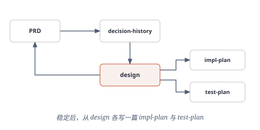

# Spec-Driven Development — 整体设计

这是 SDD 的整体设计（也叫 HLD，high-level design，只讲整体结构，不讲细节）。需求写在 [PRD](../prd/spec-driven-development-prd.md)。细节写在下面几篇，这里只放链接：

| 内容 | 写在哪 |
|---|---|
| 文档放哪、叫什么、写哪些章节、编号怎么起 | [document-standard design](../features/document-standard/design/document-standard-design.md) |
| 写 spec 分几个阶段、每个阶段用哪个 skill | [pipeline design](../features/pipeline/design/pipeline-design.md) |
| spec-write 和 spec-review 各自的输入、输出和职责边界 | [skill 契约](spec-driven-development-design-skill-contracts.md) |
| 给人读的 HTML 页面 | [reader design](../features/document-standard/design/document-standard-design-spec-reader-html.md) |

本文第一次出现的缩写和术语，都在文末的[附录：术语表](#glossary)里解释。

## Problem Statement

要解决的问题写在 PRD 的 Problem Statement：问题没定义清楚、需要 AI 帮忙发现未知、决定不断变化、人读不过来、非软件的难题也需要拆解。本文不重复。

## Solution

用五篇文档加两个 skill 来解决：

- **五篇文档**：PRD、decision-history、design、impl-plan、test-plan。前三篇反复打磨，稳定后再写后两篇。
- **两个 skill**：spec-write 负责写和改文档，spec-review 负责检查文档、给出修改建议（[ARD-AJ](../decision-history/spec-driven-development-decision-history.md#ard-aj)、[ARD-BX](../decision-history/spec-driven-development-decision-history.md#ard-bx)）。

## User Stories

用户故事见 [PRD](../prd/spec-driven-development-prd.md#user-stories)，本文不重复。

## Design

### 整体结构

SDD 由文档和 skill 两部分组成。PRD 说清楚问题，decision-history 记下方向，design 写技术方案。三篇稳定之后，impl-plan 和 test-plan 各自从 design 总结出来。所有文档放在 `docs/features/` 下面。

文档之间的关系如下。上半部分是三篇文档互相打磨的循环；循环稳定后，从 design 往下各写一篇 impl-plan 和 test-plan，两篇互不依赖：



每个阶段具体怎么走，见 [pipeline design](../features/pipeline/design/pipeline-design.md)。

### 目录结构

```
docs/features/
├── spec-driven-development/     本 feature（parent）：PRD、本文、decision-history、impl-plan、test-plan
│   └── features/
│       ├── pipeline/            sub-feature：写 spec 的阶段
│       └── document-standard/   sub-feature：文档标准和 reader HTML
└── skill-factory/               peer feature：skill 的生产和管理
```

**peer 还是 sub-feature：** 一项工作如果可以单独写 PRD、单独交付，就放在 `docs/features/` 下面做 peer feature，不要放进 `spec-driven-development/features/` 里面。

| Feature | 类型 | 一句话职责 | 详细设计 |
|---|---|---|---|
| spec-driven-development | parent | 总体需求、本文、决定记录 | 本文与 [PRD](../prd/spec-driven-development-prd.md) |
| skill-factory | peer | 生产和管理 skill | `docs/features/skill-factory/design/` |
| pipeline | sub-feature | 写 spec 的阶段和每阶段用的 skill | [pipeline design](../features/pipeline/design/pipeline-design.md) |
| document-standard | sub-feature | 文档标准和 reader HTML | [document-standard design](../features/document-standard/design/document-standard-design.md) |

### 子问题归属

PRD-L 要求每个子问题写明由谁处理。本 feature 的子问题如下：

| 子问题 | 归属 | 依据 |
|---|---|---|
| 已有的不合规文档要不要迁移 | 人决定 | [ARD-CC](../decision-history/spec-driven-development-decision-history.md#ard-cc)（重述 ARD-AF） |
| wayfinder-import 是不是 sub-feature | 人决定 | [ARD-T](../decision-history/spec-driven-development-decision-history.md#ard-t) |
| 跑分结果和报告要不要提交 | AI 查完人决定 | [ARD-AD](../decision-history/spec-driven-development-decision-history.md#ard-ad) |
| 四个非软件例子要不要建 gold | 人决定 | [ARD-AD](../decision-history/spec-driven-development-decision-history.md#ard-ad) |
| 用哪个案例来打分 | 人决定 | [ARD-BL](../decision-history/spec-driven-development-decision-history.md#ard-bl) |
| 哪些规则是 MUST、哪些是 NICE | AI 查完人决定 | [ARD-BN](../decision-history/spec-driven-development-decision-history.md#ard-bn) |

还没决定的问题见 [Open Questions](#open-questions)。

## Implementation Decisions

<a id="4-ai-文档编辑约束sdd-全-pipeline"></a><a id="dsgn-a"></a>

### DSGN-A — AI 每次改文档的上限

来源：PRD-C。

适用于 AI 对 `docs/` 下 markdown 文档的每一次修改：

| 规则 | 说明 |
|---|---|
| 单次上限 | 两条都要满足：不超过 10 行，并且不超过 200 字符（[ARD-BP](../decision-history/spec-driven-development-decision-history.md#ard-bp)） |
| 超出时 | 拆成多次改；或者由人明确授权一次大改（restructure），并记一条 ARD |
| 和文档标准的关系 | 行数上限、路径、frontmatter 见 document-standard 的 DSGN-B 和 DSGN-E |
| 怎么验证 | 测试无法检查单次改动的大小，所以这一条不作为 test-plan 的通过条件（PRD-I） |

这条规则写在 spec-write 的正文里，靠 skill 执行，不靠测试。

<a id="5-decision-history--何时写agent-写-spec-时注意"></a><a id="dsgn-b"></a>

### DSGN-B — 什么时候写 decision-history

decision-history 只记已经对外生效、或者已经逼着现实改变的方向。它不是 design 写作过程中的思考日记。

| 应该记 | 不应该记 |
|---|---|
| 别人做的决定（评审、结对、利益相关方的意见），团队需要看到 | 还只在自己脑子里、没写进 design、也没改代码的试探 |
| 自己的重大转向，并且已经改了、或者必须改已有代码（接口、路径、改名、权威换边、不兼容的行为变化） | 「想过又改主意」的每一步；design 里改一句话就能说清的事 |
| 流程要求记录的改名、撞名、推翻旧决定（见 document-standard 的 DSGN-J、DSGN-K） | 只是补充 design 正文、还没定下来的理由 |

没提交的草稿和 `raw/design/` 不能代替 decision-history。要把草稿里的结论正式写进文档时，按上表判断要不要记。AI 补写 feature spec 时，默认不自动往 decision-history 里加条目；拿不准就问人。

<a id="6-agent-规范落地claudemd-skill"></a><a id="dsgn-c"></a>

### DSGN-C — 规范要同时写进 CLAUDE.md 和 skill

DSGN-A（改动上限）、DSGN-B（什么时候记决定）以及各篇文档的职责，要让 AI 在任何会话里都记得，不能只写在本仓库的 skill 正文里（PRD-H：复用已有的机制）。

| 渠道 | 作用 |
|---|---|
| `~/.claude/CLAUDE.md`，以及项目里的 `CLAUDE.md`、`CLAUDE.local.md` | 跨会话、跨 feature 的默认 AI 行为 |
| spec-write、spec-review 两个 skill | 具体任务的操作步骤；规则来自三份标准文件 |

实现 SDD 或文档标准时，计划里必须同时包含 skill 的修改和 CLAUDE 层的条目，两边写的是同一套规范。规则的细节写在 sub-feature 的 design 里，本文只定「两个渠道都要写」这条原则。

## Testing Decisions

<a id="7-deliverable-与测试"></a><a id="dsgn-d"></a>

### DSGN-D — 交付物和测试放在哪

来源：PRD-B（用一组 skill 引导 AI 写 spec）、PRD-P（交付物只有两个 skill）。

| 项 | 约定 |
|---|---|
| 交付物 | 只有 spec-write 和 spec-review（[ARD-BX](../decision-history/spec-driven-development-decision-history.md#ard-bx)） |
| 两个 skill 读的标准文件 | `skills/spec-organize/SPEC-STANDARD.md`、`skills/spec-html-standard/SPEC-PRESENTATION.md` 和 `skills/spec-html-standard/SPEC-HTML-STANDARD.md`（[ARD-AJ](../decision-history/spec-driven-development-decision-history.md#ard-aj)、[ARD-BX](../decision-history/spec-driven-development-decision-history.md#ard-bx)） |
| 测试放在哪 | 每个 skill 的测试放在 `skills/<skill>/tests/`；跨 skill 的检查器、gold、报告放在 `skills/spec-organize/tests/`（[ARD-Q](../decision-history/spec-driven-development-decision-history.md#ard-q)） |
| 打分用的 gold | iPhone 购买案例 `skills/spec-organize/tests/gold/v1/`；本套 spec 是写法样板，由 spec-review 审查，不用来打分（[ARD-BL](../decision-history/spec-driven-development-decision-history.md#ard-bl)） |
| test-plan | 只有 parent 一份：[test-plan](../test-plan/spec-driven-development-test-plan.md)。sub-feature 不另写 |
| reader HTML | `docs/book/html/` 下，目录结构和 `docs/features/` 一样（[ARD-BF](../decision-history/spec-driven-development-decision-history.md#ard-bf)）；规范见 [reader design](../features/document-standard/design/document-standard-design-spec-reader-html.md) |

## Out of Scope

不在范围内的事项见 [PRD 的 Out of Scope](../prd/spec-driven-development-prd.md#out-of-scope)，本文不重复。

## Further Notes

<a id="8-parent-vs-sub-feature--review-齐备度"></a><a id="dsgn-e"></a>

### DSGN-E — parent 和 sub-feature 的文档齐备要求

- **parent**（`docs/features/spec-driven-development/` 这一层，不含 `features/` 下的 sub-feature）：spec-review 要确认五篇都在：prd、design、decision-history、impl-plan、test-plan。how-to 可选。缺任何一篇，记为严重度 3 及以上的问题。
- **sub-feature**（`features/<sub>/`）：不要求五篇都有，可以只有 design。review 只检查已有的文档，不能因为缺了没计划写的类型而判失败。

### 旧编号对照

2026-11-20 起，本文的规则小节从「§数字」改成 DSGN 编号（[ARD-AP](../decision-history/spec-driven-development-decision-history.md#ard-ap)、[ARD-BZ](../decision-history/spec-driven-development-decision-history.md#ard-bz)）：

| 旧 | 新 |
|---|---|
| §4 AI 文档编辑约束 | DSGN-A |
| §5 Decision history 何时写 | DSGN-B |
| §6 CLAUDE.md 与 skill 双通道 | DSGN-C |
| §7 Deliverable 与测试 | DSGN-D |
| §8 Parent 与 sub-feature 齐备度 | DSGN-E |

本文的 DSGN 编号只在 spec-driven-development 这个 feature 内有效。document-standard 也有 DSGN-A 到 DSGN-N，那是另一套；从别的文档引用时，写成「parent design 的 DSGN-E」或「document-standard 的 DSGN-B」。

## Alternatives Considered

- **一个 skill 同时负责写和审**：放弃。自己审自己写的东西，容易看不出问题（[ARD-AJ](../decision-history/spec-driven-development-decision-history.md#ard-aj)）。
- **一篇大文档装下所有内容**：放弃。很快会超过行数上限，而且「要什么」「为什么」「怎么做」混在一起，改一处要翻全篇。
- **保留 spec-pipeline 作为统一入口**：放弃。四个 skill 让使用者不知道该从哪个开始；写和审两个动作已经覆盖全部场景（[ARD-AJ](../decision-history/spec-driven-development-decision-history.md#ard-aj)）。

## Drawbacks

- 五篇文档加上 design 的 13 个必需章节，对小问题来说太重。sub-feature 可以只写 design（DSGN-E），能缓解一部分。
- decision-history 只增不减，越来越长。
- 审查和可读性判断都依赖 LLM，同样的输入两次结果可能不同。所以评测要跑 3 次（[ARD-AD](../decision-history/spec-driven-development-decision-history.md#ard-ad)）。

## Risks and Mitigations

| 风险 | 后果 | 应对 |
|---|---|---|
| 规则越加越多 | 作者把句子压成关键词，文档变得像给机器读的 | 规则分 MUST 和 NICE，只有 MUST 算失败（[ARD-BN](../decision-history/spec-driven-development-decision-history.md#ard-bn)）；可读性作为通过条件（[ARD-BO](../decision-history/spec-driven-development-decision-history.md#ard-bo)） |
| skill 正文和 spec 不一致 | AI 按 skill 做，结果违反 spec | skill 契约规定：不一致时以 spec 为准，先改 spec 再改 skill（[skill 契约](spec-driven-development-design-skill-contracts.md)） |
| 靠改 gold 来提高分数 | 分数变高，质量没变 | 打分用固定的 iPhone 案例，gold 有版本号，只在同一版本内比较（[ARD-BL](../decision-history/spec-driven-development-decision-history.md#ard-bl)、[ARD-S](../decision-history/spec-driven-development-decision-history.md#ard-s)） |
| 检查脚本没跟上规则 | 机械检查报 0 个问题，但文档其实不合规 | 规则改动后，同一批更新检查脚本和 MUST 清单（TST-M）；当前欠账列在 [impl-plan](../impl-plan/spec-driven-development-impl-plan.md) 的 IMPL-P |

## Open Questions

本表是 spec-driven-development 这个 feature（parent 这一层）唯一的未决问题清单，其他文档链到这里（[ARD-AO](../decision-history/spec-driven-development-decision-history.md#ard-ao)）。「阻塞」表示这个问题不解决，就不能进入下游阶段（[ARD-AG](../decision-history/spec-driven-development-decision-history.md#ard-ag)）。

| ID | 问题 | 目前答案 | 负责人 | 阻塞 |
|---|---|---|---|---|
| QUES-A | 两个交付的 skill 要读的标准文件和检查脚本，放在 spec-organize 和 spec-html-standard 目录，这两个目录不算交付物。只把两个 skill 装进别的项目时，怎么把这些文件一起带过去？（[ARD-C](../decision-history/spec-driven-development-decision-history.md#ard-c) 要求 skill 能独立带走） | 未定 | 人决定 | 否 |
| QUES-B | 产品级成功指标怎么量、基线是多少（PRD-G） | 延后（[ARD-N](../decision-history/spec-driven-development-decision-history.md#ard-n)） | 人决定 | 否 |
| QUES-C | 以后新增的可替换工具，例如 Map 阶段的其他辅助工具（类似 wayfinder），要不要写进 skill 契约表 | 未定 | 人决定 | 否 |
| QUES-D | 用 SDD 写出的每份 spec，要不要都带一个「Agent Loop」节，写明目标与约束、什么事件触发 AI 重跑、用什么指标自动评估 | 未定 | 人决定 | 否 |

## Reversibility

- 所有文档都是 git 里的 markdown，任何修改都可以用 git 撤回。
- 决定不删除。推翻一条决定，就新写一条 ARD，旧的划掉并链到新的，所以随时能看到当初为什么这样定。
- skill 的修改同样可以用 git 撤回。因为 skill 必须和 spec 一致，撤回 skill 时要一起撤回对应的 spec 修改。

<a id="glossary"></a>

## 附录：术语表

本表是整套 SDD 文档唯一的术语表。其他文档第一次用到这些词时，链到这里。

### 方法和流程

| 术语 | 意思 |
|---|---|
| SDD | spec-driven development：先把问题写成 spec，再让 AI 按 spec 去做 |
| LLM | 大语言模型（large language model），例如 Claude、GPT、DeepSeek |
| 阶段 | 写 spec 的四步：Create（立项）、Map（摸底）、Converge（收敛）、Downstream（写下游文档）。详见 pipeline design |
| 上游、下游 | 上游指 PRD、decision-history、design 这三篇；下游指从 design 总结出来的 impl-plan 和 test-plan |
| 阶段编排 | 决定什么时候进入哪个阶段、调用哪个 skill 的流程控制 |
| 进度回顾（recap） | AI 生成给人看的小结：做了什么、现在在哪个阶段、还剩什么、建议下一步 |
| restructure（大改） | 一次超过改动上限（10 行并且 200 字符）的修改，必须有人明确授权并记一条 ARD |

### 文档类型

| 术语 | 意思 |
|---|---|
| spec | 写清楚「要做什么、为什么、怎么做、怎么验证」的一组文档。本套方法里，spec 指一个 feature 的全部五篇文档 |
| feature spec | 一个 feature 下面所有已提交的文档：PRD、design、impl-plan、test-plan、decision-history，可能还有 how-to |
| PRD | Product Requirements Document，需求文档：要做什么、为什么做 |
| design | 设计文档：怎么做。放在 `design/` 目录，文件名是 `<feature>-design.md` |
| HLD | High-Level Design，整体设计：只讲整体结构，不讲细节。本文就是 SDD 的 HLD |
| 分篇（part）、入口文件 | design 太长时可以拆成几篇。`<feature>-design.md` 是入口文件，其他叫分篇，文件名是 `<feature>-design-<名词>.md`，名词说明这篇讲哪个方面（aspect） |
| decision-history | 决定记录：每条决定一行，最新的在最上面 |
| ARD | decision-history 里一条决定的编号前缀，例如 `ARD-A`。借自业界常用的 ADR（Architecture Decision Record，架构决策记录），本套方法里写作 ARD |
| impl-plan | Implementation plan，实现计划：先做什么、后做什么 |
| test-plan | 测试计划：怎么验证做对了 |
| how-to | 操作手册：需要人去操作结果时才写，可选 |
| Change Log | 每篇文档最后一节，记录这篇文档每次改了什么，只往末尾追加 |
| frontmatter | 文档开头两行 `---` 之间的字段，例如 `feature`、`type`、`state` |
| `raw/` | 每个 feature 下的本地草稿目录，放调研笔记、讨论记录、进度快照。不提交到 git，也不算权威 |
| INDEX | `docs/INDEX.md`，列出所有文档在哪里的目录页 |
| book | `docs/book/`，从文档自动组装出来的摘要和 HTML 页面，方便人和 AI 先浏览再打开原文 |
| reader | 给人读的 HTML 汇编页，内容来自 markdown，排版更好读 |

### feature 的组织

| 术语 | 意思 |
|---|---|
| feature | 一项可以单独写需求、单独交付的工作，对应 `docs/features/<feature>/` 一个目录 |
| parent、sub-feature | 一个大 feature（parent）下面可以有几个小的 sub-feature，放在 `<parent>/features/<sub>/` |
| peer feature | 和本 feature 平级、各自独立的另一个 feature，例如 skill-factory |
| initiative | 一组相关 feature 组成的大目标。本仓库里 spec-driven-development 既是 initiative，也是 parent feature |
| bounded context | 一块业务边界：边界内的词意思一致。拆分文档时按它来拆，而不是按行数机械切 |

### 编号

| 前缀 | 用在 | 例子 |
|---|---|---|
| PRD- | PRD 里的需求 | PRD-A |
| DSGN- | design 里的规则小节 | DSGN-B |
| PIPE- | pipeline design 里的规则小节 | PIPE-E |
| ARD- | decision-history 里的决定 | ARD-BH |
| IMPL- | impl-plan 里的任务 | IMPL-A |
| TST- | test-plan 里的测试用例 | TST-C |
| QUES- | 未决问题清单里的问题 | QUES-A |

编号后面一律用字母，不用数字；写下后不改，也不重复使用。编号只在「同一个 feature 的同一类文档」里唯一，所以引用别的 feature 时要写明是哪个，例如「document-standard 的 DSGN-B」。

### 规则的强弱

| 术语 | 意思 |
|---|---|
| MUST | 必须做到；做不到就算失败 |
| NICE | 最好做到；做不到只是提醒，不算失败 |
| SHOULD、MAY | SHOULD（应该）等同 NICE，做不到不算失败；MAY（可以）表示允许这样做，不是规则 |
| L1–L4 | 内容的四个优先级。L1 是决定性内容（需求、约束、不在范围内的事项、未决问题等），永远不删；L2 是理由；L3 是放弃的方案；L4 是参考资料。文档需要变短时，从 L4 开始删 |
| 按关注点分权威 | 不同的事实认不同的文档为准：想要的行为以 design 为准，当前实现以代码为准，接口以接口定义文件为准。冲突时先报告、再问人，不悄悄改一边 |
| UNKNOWN | 查不到的事实这样写，不许猜 |
| Unverified | 目前无法测试的项，标出原因，不作为通过条件 |
| 严重度 | spec-review 给每个问题打的分，1 到 5。只讨论 3 及以上的问题 |

### skill 和工具

| 术语 | 意思 |
|---|---|
| SVG | 一种用文字描述的矢量图片格式，浏览器能直接显示，放大不会模糊 |
| diagram-design | 一个画图的 skill，按固定的配色和字体画出 SVG 插图（ARD-CA）。它不随 SDD 一起交付；没有安装时，spec-write 不新画图，只保留已有插图 |
| GitHub Pages | GitHub 提供的静态网站托管；本项目由 GitHub Actions（GitHub 上的自动化脚本）生成网站后发布到这里（ARD-CD） |
| skill | 一份写给 AI 的操作说明（`SKILL.md`），告诉它遇到某类任务时按什么步骤做 |
| spec bundle | 整套 SDD spec 作为一个整体；版本号写在 parent PRD 的 `version`，印进 skill 用来看出 skill 出自哪一版 spec（ARD-CC） |
| spec-write | 交付的 skill 之一：新建或修改 spec 文档 |
| spec-review | 交付的 skill 之一：检查 spec 文档，只给修改建议，不直接改 |
| spec-organize | 早期的主 skill，现在不是交付物；里面放着标准文件、检查脚本和测试 |
| spec-pipeline | 早期的编排 skill，现在不是入口；它的阶段步骤保留在 pipeline design 里作参考 |
| SPEC-STANDARD.md | 文档标准的摘要：路径、章节、编号、证据等规则。完整规则在 document-standard design |
| SPEC-PRESENTATION.md | 表达规则的摘要：什么时候用表格、怎么排标题、怎么画图 |
| SPEC-HTML-STANDARD.md | 生成 HTML 页面的规则摘要，完整规则在 reader design |
| Organize、Lint、Consolidate、Sync 模式 | spec-organize 的几种工作方式：整理、扫描并修格式、合并文档、找文档和代码的不一致。详见 document-standard design 的 DSGN-L |
| `skill create`、`skill edit` | 新建和修改 `SKILL.md` 的两个已有 skill 命令 |
| 触发词 | skill 描述里写的关键词；用户说到这些词时，AI 就知道该用这个 skill |
| MkDocs | 一种把 markdown 生成网站的工具 |
| CI | 持续集成（continuous integration）：代码推送后，服务器自动跑检查和测试 |
| hook、git hook、pre-push hook | 在某个时刻自动运行的脚本。git hook 在 git 提交或推送时运行；pre-push hook 在推送之前运行 |
| Mermaid | 一种用文字描述流程图、由浏览器画出来的格式 |
| 检查脚本（checker） | `tools/run_spec_checks.py` 等 Python 脚本，自动检查路径、章节、编号这类机械规则 |
| MUST 清单（registry） | `must_registry.yaml`，列出所有 MUST 规则以及每条由谁来检查（脚本或 LLM） |
| CLAUDE.md、CLAUDE.local.md | AI 每次会话都会读的说明文件。`CLAUDE.local.md` 只在本地，不提交 |
| wayfinder、grill-with-docs、research | 已有的辅助 skill：分别用来规划路线、追问式访谈、做调研 |
| wayfinder-import | 把 wayfinder 的规划结果导入成 spec 的一项工作；曾经是 SDD 的 sub-feature，已移出（ARD-T） |
| walter-worker | 作者的另一个项目（github.com/cicidi/walter-worker），放着一组 skill 和安装脚本；它的 feature create 命令用来新建 feature 目录 |
| BMAD、GSD | 网上公开的两套 AI 开发流程框架，自带完整的任务管理和大量模板文件。SDD 故意不引入它们 |

### 评测

| 术语 | 意思 |
|---|---|
| eval（评测） | 用固定的输入跑 skill，再按规则给产出打分 |
| gold | 评测用的「标准答案」案例。打分用的 gold 是 iPhone 购买案例 |
| gold 案例、gold 版本 | 一个 gold 案例包括需求 `requirement.md` 和背景资料 `context.md`；每次修改标注，版本号加一 |
| context 包 | 模拟「人」的资料。评测时 AI 追问问题，只能从这里找答案 |
| exemplar（范例） | 被认可的一份优秀产出 |
| annotations（标注） | 对产出的好坏标注：`GOOD-*` 是应该做到的，`BAD-*` 是不该犯的错 |
| judge（判分模型） | 用来打分的 LLM，目前是 `deepseek-flash` |
| 分数 1 | MUST 合规分：通过的 MUST 条数除以 MUST 清单的总条数，必须满分 |
| 分数 2 | 和 gold 比的分数：按标注加减分，满分 10，只在同一个 gold 版本内比较，不能比上一次低 |
| 复核 | 同一个判分模型独立裁决 3 次，得出最终的通过或不通过。和 Python 检查脚本是两回事 |
| 基线 | 只装被测 skill、不加任何辅助 skill 的评测配置（`eval.yaml` 里 `grill.skills: []`） |
| run_id | 一次评测运行的名字，格式是「日期加分支名」 |
| fixture | 测试用的小样例文件。反例（neg）故意违反规则，检查脚本必须报错；正例（pos）合规，检查脚本不能误报 |
| mock MCP | 假的工具服务器。AI 调用它只会打印调用记录，不会真的下单或订票。MCP（Model Context Protocol）是 AI 调用外部工具的一种协议 |
| oracle | 判断对错的依据。本套测试的 oracle 是三份标准文件 |

## Change Log

| Date | Change |
|------|--------|
| 2026-10-31 | 收窄为 HLD only；peer/sub review 表 |
| 2026-11-03 | §4 AI 编辑约束 |
| 2026-11-03 | 术语 feature spec 合称；技术设计目录 `design/`；循环图改为 design |
| 2026-11-03 | §5 decision-history 何时写；§6 CLAUDE.md + skill 双通道 |
| 2026-11-03 | §7 Deliverable 与测试；skill 名 spec-organize / spec-review / spec-write |
| 2026-11-03 | 移除 wayfinder-import sub-feature（§2.2、§3.2） |
| 2026-11-03 | §8 parent review 须五篇齐备；sub-feature 不要求 |
| 2026-11-03 | §7 增加 spec-pipeline deliverable 与 pipeline design 指针 |
| 2026-11-03 | §7 Spec reader HTML；parent impl-plan 路径 |
| 2026-11-03 | §7 reader 规范 → **spec-html-standard**（无 spec-reader skill） |
| 2026-11-04 | §4：spec-write 已有正文；人不读 skill，靠 test plan 验收 |
| 2026-11-04 | §4：单次编辑大小测试验不了，不作为 test plan 的通过条件 |
| 2026-11-04 | 补齐 design 八章节；§7 增加 skill-contracts aspect design 指针 |
| 2026-11-04 | Intro 允许 aspect design；§7 Standard 引用 ARD-AB |
| 2026-11-04 | Out of Scope 收窄多人 decision 条款 |
| 2026-11-07 | Solution 与 §7 Deliverable 改为 spec-write、spec-review 与两份标准（ARD-AJ） |
| 2026-11-07 | §7 reader 改到 docs/book/html/（ARD-BF） |
| 2026-11-18 | §7 Deliverable 只留 spec-write 与 spec-review（ARD-BH） |
| 2026-11-20 | 补齐 Alternatives Considered、Drawbacks、Risks and Mitigations、Open Questions、Reversibility 五个必需章节；规则小节 §4–§8 改为 DSGN-A–E 并留对照表；新增全套唯一的术语表附录；User Stories 和 Out of Scope 改为链到 PRD，不再重复；gold 改为 iPhone 案例（ARD-BL）；全文改写为完整句子（ARD-BK） |
| 2026-11-20 | 第 1 轮审查后：DSGN-A 改为两条都要满足（ARD-BP）；DSGN-D 写明来源 PRD-B、PRD-P；DSGN-A 到 DSGN-E 上方保留旧锚点（ARD-AP）；术语表补上 SDD、LLM、阶段、上下游、阶段编排、进度回顾、大改、walter-worker、BMAD、GSD、分数 1、分数 2、复核、基线、run_id；SHOULD 改为等同 NICE |
| 2026-11-20 | 第 2 轮审查后：标准文件改为三份（ARD-BX）；DSGN-A 到 DSGN-E 加短锚点 `dsgn-a` 到 `dsgn-e`；对照表链到 ARD-BZ；术语表改正 ARD 的来历，补上 SPEC-HTML-STANDARD、spec-organize 的几种模式、skill create、触发词、MkDocs、Mermaid、wayfinder-import |
| 2026-11-20 | 第 3 轮审查后：交付物改链 ARD-BX；术语表补上 CI、hook；QUES-C 的「map 工具」改为 Map 阶段的辅助工具 |
| 2026-11-24 | 术语表补上 spec bundle；子问题归属的迁移一行改链 ARD-CC（ARD-AF 已划掉） |
| 2026-11-24 | 术语表补上 SVG、diagram-design、GitHub Pages |
| 2026-11-24 | 术语表写明 diagram-design 不随 SDD 交付，未安装时不新画图 |
