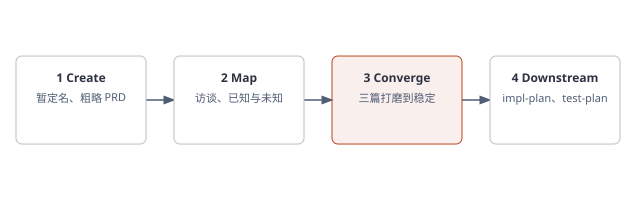

# Spec-Driven Development — 写 spec 的阶段

本篇讲写一套 spec 要经过哪几个阶段、每个阶段做什么、用哪个 skill。它是参考步骤，不是一个要单独调用的 skill：写或改 spec 从 spec-write 开始，提交前由 spec-write 询问是否跑 spec-review（[ARD-AJ](../../../decision-history/spec-driven-development-decision-history.md#ard-aj)）。

文档的格式、路径、编号、行数见 [document-standard design](../../document-standard/design/document-standard-design.md)，本篇只链过去，不重复。pipeline 没有自己的 PRD 和 test-plan，本篇提到的 `PRD-*`、`TST-*` 都指 parent 的 PRD 和 test-plan。术语见 [parent design 的术语表](../../../design/spec-driven-development-design.md#glossary)。

## Problem Statement

parent PRD 讲了上游的问题（见 [PRD](../../../prd/spec-driven-development-prd.md) 的 Problem Statement）。本篇补充写 spec 这个流程本身的问题：

- 大的需求很难拆成能执行的小 feature，新手不知道先做什么。
- skill 很多，使用者不知道什么时候该用哪个。
- 对话一长，就不知道做到哪了、还剩什么。
- 提交前很容易跳过审查。

## Solution

写 spec 分四个阶段，按顺序走：

1. **Create（立项）**：给 feature 起一个暂定名，写一份粗略的 PRD，把调研到的背景写进 `CLAUDE.local.md`。feature 目录要等 Map 阶段人确认后才建。
2. **Map（摸底）**：和人访谈，弄清已知、未知和盲区；由 AI 判断要不要拆分、要不要记决定、哪些只留草稿。可以用一个可替换的辅助工具（例如 wayfinder），但它不是 SDD 的交付物。
3. **Converge（收敛）**：PRD、design、decision-history 三篇反复打磨，直到满足 PIPE-E 的收敛条件。
4. **Downstream（下游）**：从 design 同时写出 test-plan 和 impl-plan，两篇互不依赖（和 parent PRD 的 Solution 一致）。

## User Stories

- **拆分大需求：** 作为不熟悉 spec 的人，我希望经过 Map 阶段的访谈后，能把大需求拆成几个小 feature，再一个个写齐文档。
- **恢复进度：** 作为中途离开又回来的人，我希望 AI 给我一份进度回顾（recap）：做了什么、现在在哪个阶段、还剩什么、建议下一步做什么。
- **提交前提醒：** 作为提交改动的人，我希望在准备提交时被问一句：要不要先跑 spec-review。

## Implementation Decisions

- **分工：** 标准写在三份标准文件 `SPEC-STANDARD.md`、`SPEC-PRESENTATION.md`、`SPEC-HTML-STANDARD.md`；写文档用 spec-write；审文档用 spec-review。spec-pipeline 和 spec-organize 都不是入口（[ARD-BX](../../../decision-history/spec-driven-development-decision-history.md#ard-bx)）。
- **Map 以访谈为主：** AI 判断是否要记一条决定、是否建议拆出新 feature、是否只在草稿里留个线索。人确认之后，才创建 `docs/features/<f>/` 目录（[ARD-BU](../../../decision-history/spec-driven-development-decision-history.md#ard-bu)）。
- **辅助工具可替换：** Map 阶段的辅助工具（例如 wayfinder）通过 PIPE-G 的推荐表使用，随时可以换，不在 SDD 交付物里。
- **进度记在哪：** feature 名字还没定的时候，进度只记在 `CLAUDE.local.md`（或项目的 CLAUDE 层），不建 `raw/state/` 文件。名字定了之后，正式进度记在 `docs/features/<f>/raw/state/state-<YYYY-MM-DD>.md`（document-standard 的 DSGN-B、DSGN-C）。
- **进度回顾不是正式记录：** recap 是生成给人看的，不是真相来源。真相来源是进度文件加上已提交的文档。
- **不引入重框架：** 后期的任务管理接入别的 skill，本篇不引入 BMAD、GSD 这类完整的项目管理框架。
- **协作：** 读上游文档，不悄悄改。发现冲突时按「发现、报告、问人」处理（document-standard 的 DSGN-G）。
- **编号：** 本篇的规则编号用 `PIPE-` 前缀；DSGN 留给 document-standard。
- **子问题归属表不适用：** 本篇是纯流程的 design，PIPE-L 允许这样注明。还没定的事项和它们的负责人见 [Open Questions](#open-questions)。

## Design

### PIPE-A — 流程必须做到的事

来源：PRD-A（在现有流程上改进，不另造一套）；PRD-J（从 spec-write 开始，提交前询问是否审查，进度记在哪）。

- **PIPE-A-A**：任何「写或改 spec」的任务，都从 spec-write 开始，先按 `SPEC-STANDARD.md` 判断要新建哪篇、还是改哪几篇（[ARD-AJ](../../../decision-history/spec-driven-development-decision-history.md#ard-aj)）。
- **PIPE-A-B**：路径和格式按文档标准检查。检查由检查脚本 `run_spec_checks.py` 或 spec-organize 的 Lint 模式执行。
- **PIPE-A-C**：文档内容的增删改由 spec-write 做。格式类 MUST 的问题（例如标题写法、frontmatter 字段）可以由 spec-organize 的 Lint 模式直接修。两者都遵守 parent design 的 DSGN-A（每次改动的大小上限）（[ARD-BV](../../../decision-history/spec-driven-development-decision-history.md#ard-bv)）。
- **PIPE-A-D**：提交或推送已提交文档的改动之前，询问是否先跑 spec-review。用户说不跑，就把这个选择记下来，不能悄悄跳过。
- **PIPE-A-E**：用户要求，或者对话中断后重新开始时，给出进度回顾：做了什么、现在的进度、还剩什么、建议下一步。
- **PIPE-A-F**：维护和读取 PIPE-H 定义的进度记录；按 PIPE-G 的表推荐 skill。

### PIPE-B — 四个阶段总览

| 阶段 | 目的 | 常见的失败 |
|---|---|---|
| Create | 定暂定名，收集背景 | 粗略 PRD 和背景没写进 `CLAUDE.local.md`，只存在聊天记录里 |
| Map | 弄清已知和未知，判断要不要拆 | 没访谈就建目录 |
| Converge | PRD、design、decision-history 打磨到足够稳定 | 还有没定的决定，design 就写死了 |
| Downstream | 同时写 test-plan 和 impl-plan | test-plan 没有回归检查；impl-plan 没有先后顺序 |

### PIPE-C — Create（立项）

1. 给 feature 起一个暂定名，记在 `CLAUDE.local.md`。这时还不建目录，目录在 Map 阶段人确认后才建（PIPE-D 第 5 步）。
2. 写一份粗略的 PRD，例如「推荐一台 iPhone 并协助购买」。这时还没有目录，粗略 PRD 先写在 `CLAUDE.local.md` 里；不要求一次写齐 PIPE-E-B 的五项。
3. 把搜索和调研得到的背景也写进 `CLAUDE.local.md`（或项目的 CLAUDE 层）。目录建好以后，粗略 PRD 要整理成已提交的 PRD，`CLAUDE.local.md` 不能代替它。

### PIPE-D — Map（摸底）

1. 访谈用户（评测时用 context 包代替用户），由 AI 整理出已知和未知。
2. AI 判断下一步，没有固定要产出的文件：是否建议拆出新 feature、哪些结论以后要记成决定、是否只在草稿里留个线索，还是先不拆，直接进入 Converge。要记的决定先列在 `CLAUDE.local.md`，第 5 步建好目录后再写进 decision-history。
3. 给出 Map 的结论回顾：判断的要点、建议的拆法、还没定的事项。
4. 可选：调用一个可替换的辅助工具（例如 wayfinder），但它不能代替访谈。
5. 人确认拆法和名字之后，才用 walter-worker 的 feature create 命令建 `docs/features/<f>/` 目录；要不要放进 parent 的 `features/` 下面，见 parent design 的「目录结构」一节。没有人确认，也不能移动已提交的文档（[ARD-BU](../../../decision-history/spec-driven-development-decision-history.md#ard-bu)）。
6. 拆分标准（暂行）：AI 先给出几种拆法。一个人 20 小时以内能搞清楚的，算一个 feature spec；AI 估算超过 20 小时的，拆成 peer feature 或 sub-feature。估算和判断都由 AI 做（[ARD-Y](../../../decision-history/spec-driven-development-decision-history.md#ard-y)）。
7. 子问题（PRD-L）：每个子问题标明「AI 查」「人决定」或「AI 查完人决定」。人没问到的盲区和风险，AI 必须主动提出来。

### PIPE-E — Converge（收敛）

PRD、design、decision-history 三篇反复打磨（见 parent PRD 的 Solution）。下面三个条件全部满足，才能进入 Downstream：

- **PIPE-E-A**：没有阻塞的未决问题。每个未决问题都写在本 feature 的问题清单里，并在「阻塞」一列标明是或否。只要还有标「是」的问题没解决，就不能进入 Downstream（[ARD-AG](../../../decision-history/spec-driven-development-decision-history.md#ard-ag)）。
- **PIPE-E-B**：PRD 写清了限制、偏好、时间、资源、工具五项；不适用的写 not apply，不能留空。design 和 decision-history 两篇都已存在（[ARD-Z](../../../decision-history/spec-driven-development-decision-history.md#ard-z)）。
- **PIPE-E-C**：design 列出了它依赖的决定和还没定的事项，并写清了实现需要的接口和边界。实现任务的细节留到 Downstream 再定。

### PIPE-F — Downstream（下游）

- test-plan 和 impl-plan 同时开始写，互不依赖，都从 design 总结出来。
- **PIPE-F-A（test-plan）**：每个任务都有完成检查和回归检查。回归检查用来确认改动没有弄坏原来能用的功能。
- **PIPE-F-B（impl-plan）**：每个任务写明依赖谁、挡住了谁；被挡住的后做，没被挡住的先做。

### PIPE-G — 每个阶段推荐的 skill

| 阶段 | 场景 | 推荐 | 是否必须 |
|---|---|---|---|
| Map 结束、人确认后 | 建 feature 目录 | walter-worker 的 feature create | 必须 |
| Create | 补充背景 | research（举例） | 可选 |
| Map | 摸底、辅助拆分 | 可替换的辅助工具（例如 wayfinder） | 可选 |
| Converge | 写或改文档 | spec-write | 有改动时必须 |
| Converge | 检查路径和格式 | `run_spec_checks.py` 或 spec-organize 的 Lint | 新建、移动、合并文档后必须 |
| 任何阶段 | 提交前 | spec-review | 询问（PIPE-A-D） |
| Downstream | 写 test-plan 和 impl-plan | spec-write，加上路径和格式检查 | 必须 |

wayfinder 等辅助工具随时可以换，不是 SDD 必须安装的交付物。

### PIPE-H — 进度记录

来源：PRD-J、[ARD-BT](../../../decision-history/spec-driven-development-decision-history.md#ard-bt)。

| 时段 | 记在哪 | 记什么 |
|---|---|---|
| feature 名字还没定 | `CLAUDE.local.md`（项目的 CLAUDE 层） | 阶段、粗略需求、Map 笔记、未定事项 |
| feature 名字已定 | `docs/features/<f>/raw/state/state-<YYYY-MM-DD>.md` | `phase`（Create、Map、Converge、Downstream 之一）、`feature`、`open_items`、`last_action`，可选 `scratch_ref`（指向相关草稿的路径） |

- 进度回顾读取进度记录和已提交的文档，发给用户看；回顾本身默认不提交。
- 有方向性的结论，要正式写进 decision-history、PRD 或 design，不能长期只留在进度记录里。

### PIPE-I — 协作、来源和齐备

- 读上游文档，不悄悄改；有分歧就报告并问人（document-standard 的 DSGN-G）。
- 多人的决定冲突时，以 decision-history 里时间较晚的为准；看不出先后就问用户；AI 不猜（PRD-F）。
- 决定变了，要点名哪些下游文档需要复查：PRD、design、impl-plan、test-plan。
- parent 和 sub-feature 的齐备要求见 parent design 的 DSGN-E：parent 五篇都要有，sub-feature 不要求。这件事由 spec-review 检查，本篇只转交，不重复规则。

### PIPE-J — 本篇管什么、不管什么

| 本篇管 | 本篇不管 |
|---|---|
| 阶段、入口、skill 推荐、进度记录、进度回顾、提交前询问 | frontmatter、路径、编号的细则（见 document-standard） |
| 收敛条件、下游两篇同时写 | 辅助工具和 research 等 skill 的正文 |
| 轻量的进度记录 | 完整的任务管理框架（BMAD、GSD 这类） |

### PIPE-K — 非软件问题对应到五篇文档

依据 PRD-K、PRD-Q：非软件的难题也用同样五篇文档，不新增文档类型。

| 内容 | 放在哪 |
|---|---|
| 调研、学习笔记、原始资料 | `raw/research/<主题>.md`（不提交，不算权威） |
| 决定 | decision-history（`ARD-*`） |
| 方案、执行步骤 | design；需要排先后顺序的执行步骤放 impl-plan |
| 验证 | test-plan |

`raw/` 里的结论要正式写进文档时，在文档里用一句话写出结论，并链到 `raw/` 文件作依据，不把草稿整段搬进来（[ARD-BW](../../../decision-history/spec-driven-development-decision-history.md#ard-bw)）。

执行只做到 mock（PRD-O）：所有例子共用一个 mock MCP 服务器，打印出调用记录就算成功，不真下单、不真订票（[ARD-X](../../../decision-history/spec-driven-development-decision-history.md#ard-x)）。四个例子（盖 shed、北京旅游、数学题、股票）写进 skill 正文，不在本仓库建 gold。

### PIPE-L — 子问题归属和证据

来源：PRD-L（子问题归属）、PRD-N（结论要有依据，查不到写 UNKNOWN）。

有子问题的 feature，它的 design 必须有一张「子问题归属」表。纯标准或纯流程的 design 可以注明不适用。

| 子问题 | 归属 | 依据 |
|---|---|---|
| <问题> | `AI 查`、`人决定` 或 `AI 查完人决定` | `raw/` 路径（其他读者打不开也可以，[ARD-BW](../../../decision-history/spec-driven-development-decision-history.md#ard-bw)）、网址或 `ARD-*` 编号 |

- 归属只能是这三种之一。人没问到的盲区和风险，AI 必须主动加行。
- 依据必须能追溯；查不到写 `UNKNOWN`，不能写推测。
- spec-review 检查两种问题：有结论却没有依据；该写 `UNKNOWN` 的地方写成了事实。
- 允许：如果每个子问题都已经是问题清单里的一行，并且每行都有负责人和依据，design 可以只放一个链接，不再抄一张表（[ARD-AY](../../../decision-history/spec-driven-development-decision-history.md#ard-ay)）。

## Testing Decisions

测试见 parent 的 [test-plan](../../../test-plan/spec-driven-development-test-plan.md)。本篇至少要覆盖：

- **阶段编排**：入口、进度回顾、提交前询问、进度记录的切换。暂时没有可执行的测试，标为 Unverified（PRD-I）。
- **PRD**：五项都写了，或注明 not apply。
- **decision-history**：方向性的决定都有 ARD 编号；推翻旧决定用删除线加链接（document-standard 的 DSGN-J）。
- **design**：写明依赖的决定，未决事项都在问题清单里。
- **test-plan 和 impl-plan**：两篇都在；test-plan 有完成检查和回归检查。
- **文档之间的追溯**：PRD 的每条需求在 design 里有对应的规则（TST-O），并且在 test-plan 的追溯表里有对应的测试，或者标为 Unverified。
- **PRD-N**：正式结论链到事实；评测时答案只能来自 context 包。
- **PRD-O**：所有例子共用一个 mock MCP 服务器，打印出调用记录就算通过。
- **PRD-M**：可读性由 TST-V 判定。

## Out of Scope

- wayfinder、feature create、research 等 skill 的正文和部署。
- BMAD、GSD 这类完整的进度和任务管理框架，以及在仓库里铺满模板文件。
- 流程编排的具体实现（prompt、代码、hook）。
- impl-plan 阶段的任务粒度，以及 parent impl-plan 的内容。
- 重复写 document-standard 的规则。

## Further Notes

Map 的拆分标准见 PIPE-D 第 6 步。还没定的事项见 [Open Questions](#open-questions)。

**子条款编号对照。** 2026-11-20 起，子条款从数字改成字母，和 document-standard 的 DSGN-F 一致（[ARD-BR](../../../decision-history/spec-driven-development-decision-history.md#ard-br)）：

| 旧 | 新 |
|---|---|
| PIPE-A1 到 PIPE-A6 | PIPE-A-A 到 PIPE-A-F |
| PIPE-E1、PIPE-E2、PIPE-E3 | PIPE-E-A、PIPE-E-B、PIPE-E-C |
| PIPE-F1、PIPE-F2 | PIPE-F-A、PIPE-F-B |

## Alternatives Considered

- **把 wayfinder-import 固定成一个 sub-feature：** 放弃。辅助工具必须可以替换（[ARD-T](../../../decision-history/spec-driven-development-decision-history.md#ard-t)）。
- **每个阶段一个 skill：** 放弃。写和审两个 skill 已经覆盖了所有阶段（[ARD-AJ](../../../decision-history/spec-driven-development-decision-history.md#ard-aj)），按阶段拆会让职责重复。
- **固定的瀑布流程，跳过 Map：** 放弃。未知很多的问题，会漏掉该拆的部分。

## Drawbacks

- 访谈又贵又慢，小改动也要走一遍。
- Map 阶段的产出没法用脚本检查，只能靠人确认。

## Risks and Mitigations

| 风险 | 应对 |
|---|---|
| AI 没经确认就创建 `docs/features/<f>/` | PIPE-D 第 5 步规定必须人确认 |
| AI 判断错了当前阶段 | 以进度文件 `raw/state/state-<日期>.md` 和 `CLAUDE.local.md` 为准，不凭记忆 |

## Open Questions

本表是 pipeline 这个 feature 唯一的未决问题清单（[ARD-AO](../../../decision-history/spec-driven-development-decision-history.md#ard-ao)）。

| ID | 问题 | 目前答案 | 负责人 | 阻塞 |
|---|---|---|---|---|
| QUES-A | 阶段编排怎么测试？目前没有可执行的测试（PRD-I） | 标为 Unverified | 人决定 | 否 |
| QUES-B | 进度回顾的格式是否适用于所有项目 | 未定 | 人决定 | 否 |
| QUES-C | 后期的任务管理接入哪个 skill | 未定 | 人决定 | 否 |
| QUES-D | PIPE-E 的收敛条件，自动检查怎么实现 | 未定 | AI 查完人决定 | 否 |

## Reversibility

- 阶段是叠加的：去掉 Map，不影响 Create、Converge、Downstream。
- 进度文件可以不用，退回到只在 `CLAUDE.local.md` 里记录。

## Change Log

| Date | Change |
|------|--------|
| 2026-10-30 | Initial creation; pipeline split out of parent design |
| 2026-10-30 | Problem/Solution link to parent PRD; D1–D8 artifact stages |
| 2026-11-03 | document-standard 引用 DSGN-A–M；移除 wayfinder-import 引用 |
| 2026-11-03 | 重写：spec-pipeline 编排；四阶段；PIPE-*；Map interview；state CLAUDE.local → raw/state |
| 2026-11-04 | PIPE-D 第 6 点：20 小时内一个 feature spec，超出拆 peer 或 sub；估算和评判由 AI 做 |
| 2026-11-04 | PIPE-E2：PRD 写清五项，没有则 not apply；design 与 decision history 都在才进 Downstream |
| 2026-11-04 | PIPE-I：多人 decision 按 history 时间，否则问用户，AI 不猜测 |
| 2026-11-04 | PIPE-D 第 7 点：子问题标归属，AI 必须提出人没问的风险 |
| 2026-11-04 | PIPE-K 非软件五篇映射；PIPE-L 归属与证据；spec-pipeline 标 Unverified |
| 2026-11-04 | PIPE-E1 加 blocking 字段；PIPE-L 标注纯标准/编排 design 可 not apply |
| 2026-11-06 | PIPE-F2：impl 写依赖与挡住谁；被挡住的后做 |
| 2026-11-07 | 入口改为 spec-write 与 spec-review；本篇步骤不再是入口 skill（ARD-AJ） |
| 2026-11-07 | 开头与 PIPE-A1：写改 spec 从 spec-write 进入（ARD-AJ） |
| 2026-11-07 | PIPE-L：tracker 已有 Owner 与 Evidence 时，design 可链过去（ARD-AY） |
| 2026-11-20 | Solution 不再说 spec-pipeline 是统一入口，四阶段改为编号步骤（ARD-AJ）；PIPE-A2 和 PIPE-G 不再要求调用 spec-organize，改为检查脚本或 Lint；PIPE-C 的「六要素」改为 PIPE-E2 的五项（ARD-Z）；PIPE-E1 写明阻塞标记写在问题清单的「阻塞」列（ARD-AG）；Alternatives 不再引用已推翻的 ARD-AB；删除指向已不存在的 workflow HTML 的链接；Open Questions 改为 QUES 清单；全文改写为完整句子（ARD-BK） |
| 2026-11-20 | 第 1 轮审查后：子条款编号改为字母并在 Further Notes 留对照表（ARD-BR）；PIPE-H 链到 ARD-BT；Testing Decisions 改正 TST-O 的说法；「可以（MAY）」改为「允许」 |
| 2026-11-20 | 第 2 轮审查后：建目录从 Create 移到 Map 人确认后（ARD-BU）；PIPE-A-C 允许 Lint 直接修格式（ARD-BV）；PIPE-K、PIPE-L 写明 raw/ 可作依据（ARD-BW），PIPE-K 加上 PRD-O 的 mock 规则；开头写明 PRD-*、TST-* 指 parent |
| 2026-11-20 | 第 3 轮审查后：粗略 PRD 和要记的决定在目录建好前先写在 CLAUDE.local.md（PIPE-B、PIPE-C、PIPE-D）；PIPE-L 写明来源 PRD-L、PRD-N；子问题归属表不适用的理由改为只引 PIPE-L；标准文件改为三份（ARD-BX） |
