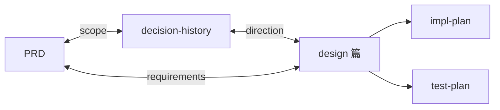
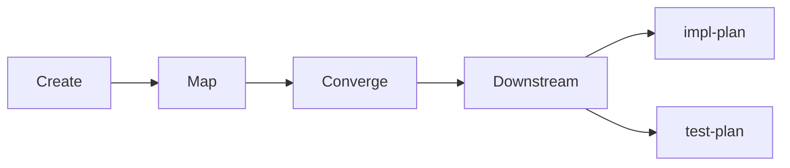
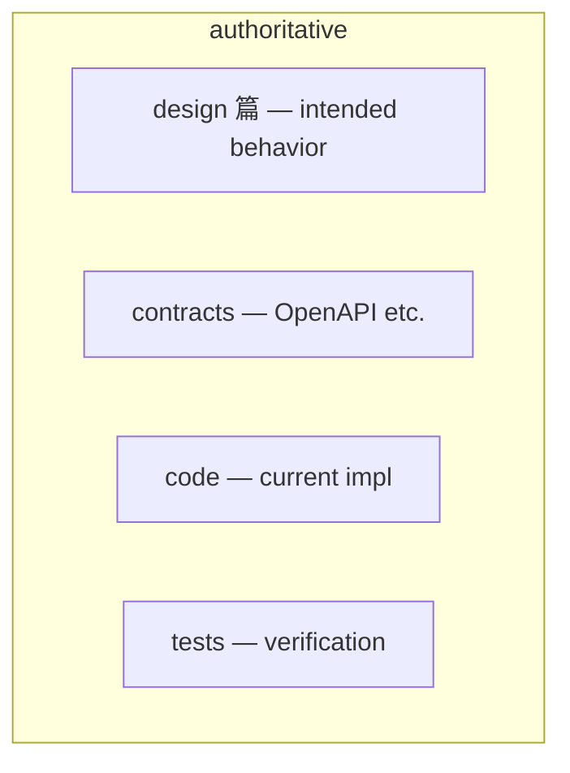

# Mermaid patterns for spec reader HTML

Use in committed `.md` **fenced blocks**; `tools/build_sdd_reader.py` renders ` ```mermaid ` as diagrams (requires network for CDN in browser).

## SDD artifact loop (parent PRD)



## Pipeline phases



## Authority by concern (read-only summary)



Copy into **design** or **pipeline** prose only when user approves **spec** edits; otherwise embed in HTML reader assembly from this file.
