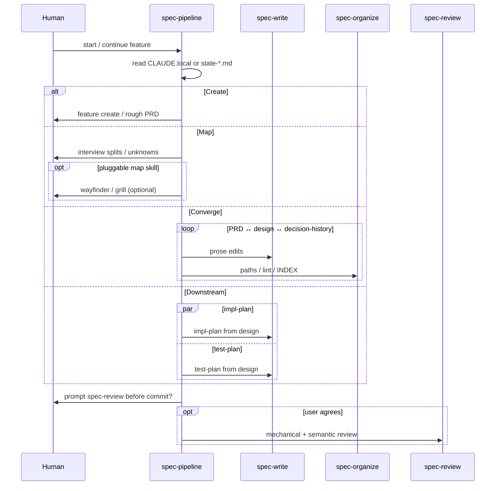
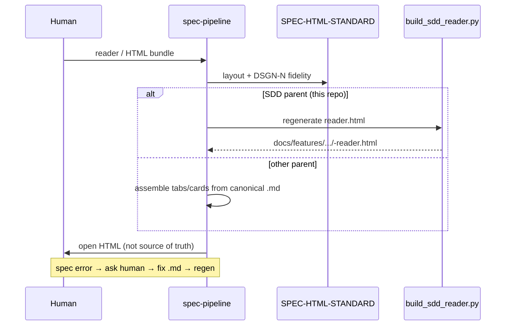

# spec-pipeline — sequence diagrams

Operational view of **PIPE-*** flows. Normative rules stay in `pipeline-design.md`; routing in **`INTEGRATIONS.md`**. Sample Mermaid for `.md`/reader: `skills/spec-html-standard/MERMAID-PATTERNS.md`.

## Phase loop (Create → Downstream)



## Mechanical lint before review

```mermaid
sequenceDiagram
    participant P as spec-pipeline
    participant L as run_spec_checks.py
    participant C as TST-B checkers
    participant R as spec-review

    P->>L: docs/features/<f>/
    L->>C: per-file + tree (collision, INDEX, no_commit)
    C-->>L: findings (check id + path)
    L-->>P: exit 0 | nonzero
    P->>R: cite findings; suggest only
```

## Human-readable reader (derived HTML)



## Gold eval prep (TST-C scaffold)

```mermaid
sequenceDiagram
    participant U as Human
    participant P as spec-pipeline
    participant O as spec-organize
    participant G as gold v1 assets

    U->>P: eval / gold iPhone scenario
    P->>G: eval_preflight + check_gold_run_scaffold
    G-->>P: TST-C-RUNBOOK.md + runs/_template
    P->>O: interview (context.md only)
    O->>G: runs/<model>/interview.md (local)
    Note over P,G: exemplar/ after TST-D; no model calls in CI
```
