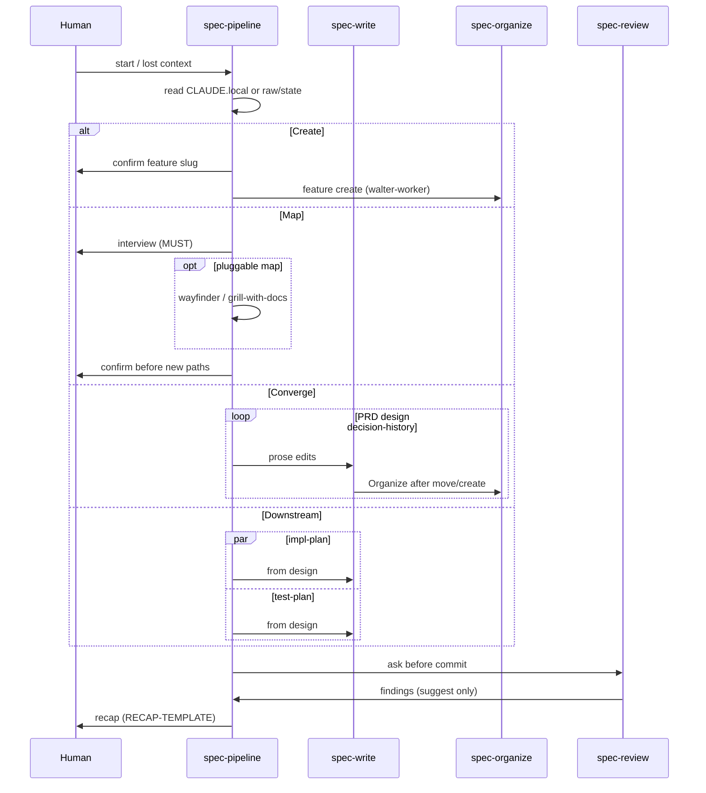
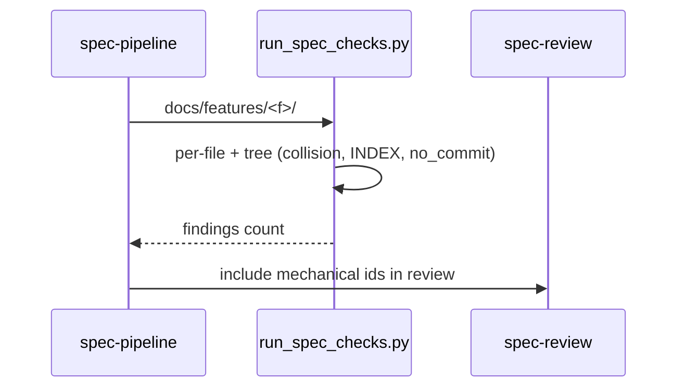
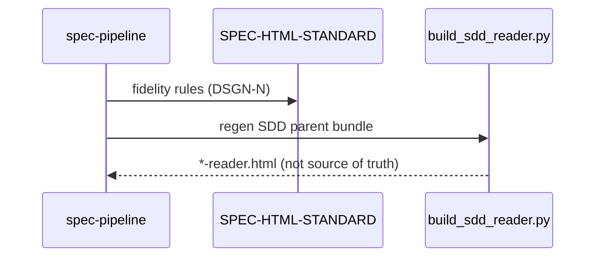

# spec-pipeline — sequence (operational)

Norm: **PIPE-*** in pipeline design. Diagrams for recap / onboarding only.

## Create → Map → Converge → Downstream

## Mechanical lint before review

## HTML reader (derived)

See **INTEGRATIONS.md** for skill routing table.
